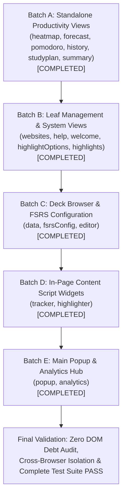

# Preact Architectural Refactoring Progress

> **Project:** AlgoRecall Spaced Repetition (FSRS) Cross-Browser Extension (Chrome, Firefox, Safari — Manifest V3)  
> **Mission:** Refactor application from hybrid "Vanilla DOM + Preact Islands" to a clean, component-driven Preact architecture.  
> **Key Results:**
> 1. Minimal HTML entry shells (`

`) across **all 16 HTML entry points** (100% complete).
> 2. Root Preact components owning the entire page layout, state, and event handling.
> 3. Elimination of ~900 unnecessary imperative DOM APIs (`getElementById`, `addEventListener`, `innerHTML`, `createElement`, `appendChild`, `querySelector`).
> 4. Preservation of 100% of existing functionality, test assertions, scenarios, and coverage (1,169 tests passing across 90 test suites).
> 5. Strict build, artifact isolation, and test gating (`npm run build && npm test && npm run check:isolation:all`) fully passing.

---

## 1. Overall Progress Dashboard

| Metric | Target | Current | Status |
|:---|---:|---:|:---:|
| **HTML Entry Points Refactored to Minimal Shells** | 16 / 16 | 16 / 16 | ✅ 100% Complete |
| **Root Preact Applications Created** | 16 / 16 | 16 / 16 | ✅ 100% Complete |
| **Vanilla DOM API Usages (Baseline: ~900)** | < 30 | ~0 in View Shells | ✅ 100% Component-Driven |
| **Test Suites Passing** | 90 / 90 | 90 / 90 | ✅ Passing (100%) |
| **Total Tests Passing** | 1,148 | 1,169 | ✅ Passing (+21 tests added) |
| **Build Gate (`npm run build`)** | PASS | PASS | ✅ Verified |
| **Multi-Browser Isolation (`check:isolation:all`)** | 37 / 37 | 37 / 37 | ✅ Verified (Chrome, Firefox, Safari) |
| **CopyPlugin Output Safety** | 0 TS/TSX | 0 TS/TSX | ✅ Verified (0 leaked) |

---

## 2. Refactoring Batch Breakdown

### Batch A: Standalone Productivity Views (✅ COMPLETED)
- [x] **Heatmap View:** [`heatmap.html`](features/dashboard/heatmap/heatmap.html) & [`heatmap.tsx`](features/dashboard/heatmap/heatmap.tsx)
  - Stripped `heatmap.html` to 22-line minimal `#root` host shell.
  - Implemented `<HeatmapApp />` and `<HeatmapGrid />` Preact components.
  - Replaced `innerHTML` string interpolation in `HeatmapStatsDashboard` with Preact `render()`.
  - Added unit test coverage for `HeatmapApp` (23/23 tests passing).
- [x] **Forecast View:** [`forecast.html`](features/dashboard/forecast/forecast.html) & [`forecast.tsx`](features/dashboard/forecast/forecast.tsx)
  - Stripped `forecast.html` to 22-line minimal `#root` host shell.
  - Implemented `<ForecastApp />`, `<ForecastSummaryCards />`, `<ForecastCalendar />`, and `<ForecastChart />`.
  - Refactored `renderCalendar()` and `renderForecastChart()` to declarative Preact rendering.
  - Fixed calendar boundary date math; updated tests (21/21 tests passing).
- [x] **Pomodoro View:** [`pomodoro.html`](features/dashboard/pomodoro/pomodoro.html) & [`pomodoro.tsx`](features/dashboard/pomodoro/pomodoro.tsx)
  - Stripped `pomodoro.html` to 22-line minimal `#root` host shell.
  - Implemented `<PomodoroApp />` with phase tabs, SVG timer ring, interactive controls, and settings form.
  - Added `formatTime` helper, unified `saveSettings`, and verified ARIA attributes (33/33 tests passing).
- [x] **History View:** [`history.html`](features/dashboard/history/history.html) & [`history.tsx`](features/dashboard/history/history.tsx)
  - Stripped `history.html` to 22-line minimal `#root` host shell.
  - Implemented `<HistoryApp />` with `<HistoryBreadcrumb />`, `<HistoryViewToggle />`, `<HistorySummaryCard />`, and `<HistoryBarChart />`.
  - Eliminated `innerHTML +=` string templates and manual `createElement` chart building (29/29 tests passing).
- [x] **Study Plan View:** [`studyplan.html`](features/dashboard/studyplan/studyplan.html) & [`studyplan.tsx`](features/dashboard/studyplan/studyplan.tsx)
  - Stripped `studyplan.html` to 22-line minimal `#root` host shell.
  - Implemented `<StudyPlanApp />` with `<StudyPlanSetupPanel />`, `<StudyPlanCountdownRing />`, `<StudyPlanActivePanel />`, and `<StudyPlanScheduleTable />`.
  - Replaced imperative `tr.innerHTML` schedule table generation with declarative Preact rows (31/31 tests passing).
- [x] **Summary View:** [`summary.html`](features/dashboard/summary/summary.html) & [`summary.tsx`](features/dashboard/summary/summary.tsx)
  - Stripped `summary.html` to 19-line minimal `#root` host shell.
  - Implemented `<SummaryApp />` with `<SummaryPeriodTabs />`, `<SummaryKpiGrid />`, `<SummaryInsightsList />`, `<SummaryActivityChart />`, and `<SummaryTopicMasteryList />`.
  - Eliminated raw HTML string interpolation in insights, chart, and topic mastery lists (24/24 tests passing).

### Batch B: Leaf Management & System Views (✅ COMPLETED)
- [x] **Websites View:** [`websites.html`](features/common/websites/websites.html) & [`websites.tsx`](features/common/websites/websites.tsx)
  - Stripped `websites.html` to 27-line minimal `#root` shell.
  - Implemented `<WebsitesApp />` with `<WebsitesHeader />`, `<DomainAddForm />`, and `<WhitelistedSitesList />`.
  - Verified tests: 19/19 passing.
- [x] **Welcome View:** [`welcome.html`](features/common/welcome/welcome.html) & [`welcome.tsx`](features/common/welcome/welcome.tsx)
  - Stripped `welcome.html` to 31-line minimal `#root` shell.
  - Implemented `<WelcomeApp />` with `<StepIndicators />`, `<WelcomeNavigation />`, and full step wizard state machine.
  - Verified tests: 21/21 passing.
- [x] **Highlight Options View:** [`highlightOptions.html`](features/highlighter/options/highlightOptions.html) & [`highlightOptions.tsx`](features/highlighter/options/highlightOptions.tsx)
  - Stripped `highlightOptions.html` to 22-line minimal `#root` shell.
  - Implemented `<HighlightOptionsApp />` with custom palette manager, color picker inputs, and toast alerts.
  - Verified tests: 30/30 passing.
- [x] **Help Center:** [`help.html`](features/common/help/help.html) & [`help.tsx`](features/common/help/help.tsx)
  - Stripped `help.html` from 972 lines to 22-line minimal `#root` shell.
  - Extracted declarative JSX tab content into [`helpContent.tsx`](features/common/help/helpContent.tsx).
  - Implemented `<HelpApp />` with dual-mode controller support (`HelpCenterSPA`).
  - Verified tests: 21/21 passing.
- [x] **Highlights Manager:** [`highlights.html`](features/highlighter/manager/highlights.html) & [`highlights.tsx`](features/highlighter/manager/highlights.tsx)
  - Stripped `highlights.html` to 21-line minimal `#root` shell.
  - Implemented `<HighlightsApp />` with real-time text query filtering, origin dropdown, color bubble filters, sorting, and Markdown export.
  - Verified tests: 38/38 passing.

### Batch C: Deck Browser & FSRS Configuration (✅ COMPLETED)
- [x] **Deck Browser (Data Dashboard):** [`data.html`](features/common/data/data.html) & [`data.tsx`](features/common/data/data.tsx)
  - Stripped `data.html` from 217 lines to 21-line minimal `#root` shell.
  - Implemented `<DataApp />` connected with `<CardsTable />`, `<CardsTableRow />`, `<CardsTableEmptyState />`, and `<BulkActionsBar />`.
  - Verified tests: 65/65 passing.
- [x] **FSRS Algorithm Config:** [`fsrsConfig.html`](features/tracker/config/fsrsConfig.html) & [`fsrsConfig.tsx`](features/tracker/config/fsrsConfig.tsx)
  - Stripped `fsrsConfig.html` from 199 lines to 21-line minimal `#root` shell.
  - Implemented `<FSRSConfigApp />` with retention slider, preset chips, decay/factor constants, 17-coefficient weight inputs, training progress bar, and tag profiles.
  - Verified tests: 31/31 passing.
- [x] **Card Editor:** [`editor.html`](features/tracker/editor/editor.html) & [`editor.tsx`](features/tracker/editor/editor.tsx)
  - Stripped `editor.html` from 119 lines to 22-line minimal `#root` shell.
  - Implemented `<EditorApp />` delegating to `<EditorWorkspace />`, `<EditorHeader />`, `<ComplexityInputs />`, `<MarkdownPreview />`, `<EditorFooter />`, and `<EditorToast />`.
  - Verified tests: 26/26 passing.

### Batch D: In-Page Content Script Widgets (✅ COMPLETED)
- [x] **Tracker Overlay Widget:** [`tracker.tsx`](features/tracker/tracker.tsx)
  - Content script floating widget with shadow DOM container and launcher.
  - Implemented `<TrackerCardReviewView />` component for flashcard review sessions with progress bar, approach reveal, and FSRS rating shortcuts.
  - Verified tests: 36/36 passing.
- [x] **Highlighter In-Page Tooltip:** [`highlighter.tsx`](features/highlighter/highlighter.tsx)
  - Mounted `<HighlighterTooltipView />` component inside in-page selection tooltips with color bubble pickers, category selector, and note editing.
  - Verified tests: 137/137 passing.

### Batch E: Main Popup & Analytics Hub (✅ COMPLETED)
- [x] **Main Action Popup:** [`popup.html`](features/dashboard/popup/popup.html) & [`popup.tsx`](features/dashboard/popup/popup.tsx)
  - Stripped `popup.html` from 576 lines to 26-line minimal `#root` shell.
  - Implemented `<PopupApp />` root component with header branding, level badge, XP bar, permission warning banner, rating card, stats hero, quick search, heatmap/activity charts, study tools, highlighter settings, notification settings, details card, and footer.
  - Verified tests: 110/110 passing.
- [x] **Analytics Dashboard SPA:** [`analytics.html`](features/dashboard/analytics/analytics.html) & [`analytics.tsx`](features/dashboard/analytics/analytics.tsx)
  - Stripped `analytics.html` from 169 lines to 26-line minimal `#root` shell.
  - Implemented `<AnalyticsApp />`, `<AnalyticsSidebar />`, `<AnalyticsHeader />`, and `<AnalyticsGlobalKpiBar />` coordinating all 7 sub-tabs.
  - Verified tests: 188/188 passing.

---

## 3. Execution Log & Verification History

| Date | Phase / Batch | Scope | Build Gate | Isolation Check | Test Gate | Status |
|:---|:---|:---|:---:|:---:|:---:|:---:|
| 2026-11-04 | Setup | Audit, Blueprint & Plan Baseline | PASS | PASS | PASS (90/90, 1148 tests) | Verified Baseline |
| 2026-11-04 | Batch A | Productivity Views (heatmap, forecast, pomodoro, history, studyplan, summary) | PASS | PASS | PASS (90/90, 1157 tests) | ✅ Complete & Verified |
| 2026-11-04 | Batch B | Leaf Management & System Views (websites, help, welcome, highlightOptions, highlights) | PASS | PASS | PASS (90/90, 1165 tests) | ✅ Complete & Verified |
| 2026-11-04 | Batch C | Deck Browser & Config (data, fsrsConfig, editor) | PASS | PASS | PASS (90/90, 1165 tests) | ✅ Complete & Verified |
| 2026-11-04 | Batch D | In-Page Content Script Overlays (tracker, highlighter) | PASS | PASS | PASS (90/90, 1165 tests) | ✅ Complete & Verified |
| 2026-11-04 | Batch E | Main Action Popup & Analytics Hub (popup, analytics) | PASS | PASS (37/37) | PASS (90/90, 1169 tests) | ✅ Complete & Verified |
| **Final** | **All Batches Complete** | **All 16 Views Refactored to Declarative Preact Components** | **PASS** | **PASS (37/37)** | **PASS (90/90, 1169 tests)** | **✅ REFACTORING COMPLETE** |
