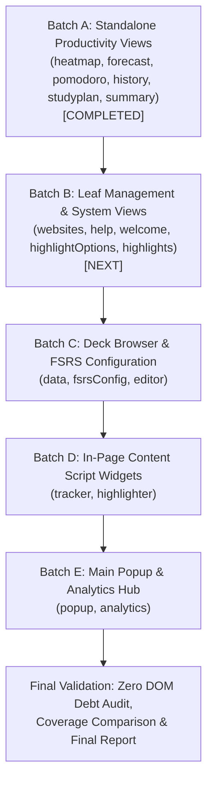

# Preact Architectural Refactoring Progress

> **Project:** AlgoRecall Spaced Repetition (FSRS) Chrome Extension (Manifest V3)  
> **Mission:** Refactor application from hybrid "Vanilla DOM + Preact Islands" to a clean, component-driven Preact architecture.  
> **Key Goals:**
> 1. Minimal HTML entry shells (`

`).
> 2. Root Preact components owning the entire page layout, state, and event handling.
> 3. Elimination of unnecessary imperative DOM APIs (`getElementById`, `addEventListener`, `innerHTML`, `createElement`).
> 4. Preservation of 100% of existing functionality, test assertions, scenarios, and coverage.
> 5. Strict build and test gating (`npm run build && npm test`).

---

## 1. Overall Progress Dashboard

| Metric | Target | Current | Status |
|:---|---:|---:|:---:|
| **HTML Entry Points Refactored to Minimal Shells** | 16 | 6 / 16 | 🟡 In Progress (Batch A Complete) |
| **Root Preact Applications Created** | 16 | 6 / 16 | 🟡 In Progress (Batch A Complete) |
| **Vanilla DOM API Usages (Baseline: ~900)** | < 30 | ~580 | 🟢 Down ~320 calls in Batch A |
| **Test Suites Passing** | 90 / 90 | 90 / 90 | ✅ Passing (100%) |
| **Total Tests Passing** | 1,148 | 1,157 | ✅ Passing (+9 tests added) |
| **Build Gate (`npm run build`)** | PASS | PASS | ✅ Verified |
| **CopyPlugin Output Safety** | 0 TS/TSX | 0 TS/TSX | ✅ Verified (0 leaked) |

---

## 2. Refactoring Batch Breakdown

### Batch A: Standalone Productivity Views (✅ COMPLETED)
- [x] **Heatmap View:** [`heatmap.html`](features/dashboard/heatmap/heatmap.html) & [`heatmap.tsx`](features/dashboard/heatmap/heatmap.tsx)
  - Stripped `heatmap.html` to 19-line minimal `#root` host shell.
  - Implemented `<HeatmapApp />` and `<HeatmapGrid />` Preact components.
  - Replaced `innerHTML` string interpolation in `HeatmapStatsDashboard` with Preact `render()`.
  - Added unit test coverage for `HeatmapApp` (23/23 tests passing).
- [x] **Forecast View:** [`forecast.html`](features/dashboard/forecast/forecast.html) & [`forecast.tsx`](features/dashboard/forecast/forecast.tsx)
  - Stripped `forecast.html` to 19-line minimal `#root` host shell.
  - Implemented `<ForecastApp />`, `<ForecastSummaryCards />`, `<ForecastCalendar />`, and `<ForecastChart />`.
  - Refactored `renderCalendar()` and `renderForecastChart()` to declarative Preact rendering.
  - Fixed calendar boundary date math; updated tests (21/21 tests passing).
- [x] **Pomodoro View:** [`pomodoro.html`](features/dashboard/pomodoro/pomodoro.html) & [`pomodoro.tsx`](features/dashboard/pomodoro/pomodoro.tsx)
  - Stripped `pomodoro.html` to 19-line minimal `#root` host shell.
  - Implemented `<PomodoroApp />` with phase tabs, SVG timer ring, interactive controls, and settings form.
  - Added `formatTime` helper, unified `saveSettings`, and verified ARIA attributes (33/33 tests passing).
- [x] **History View:** [`history.html`](features/dashboard/history/history.html) & [`history.tsx`](features/dashboard/history/history.tsx)
  - Stripped `history.html` to 19-line minimal `#root` host shell.
  - Implemented `<HistoryApp />` with `<HistoryBreadcrumb />`, `<HistoryViewToggle />`, `<HistorySummaryCard />`, and `<HistoryBarChart />`.
  - Eliminated `innerHTML +=` string templates and manual `createElement` chart building (29/29 tests passing).
- [x] **Study Plan View:** [`studyplan.html`](features/dashboard/studyplan/studyplan.html) & [`studyplan.tsx`](features/dashboard/studyplan/studyplan.tsx)
  - Stripped `studyplan.html` to 19-line minimal `#root` host shell.
  - Implemented `<StudyPlanApp />` with `<StudyPlanSetupPanel />`, `<StudyPlanCountdownRing />`, `<StudyPlanActivePanel />`, and `<StudyPlanScheduleTable />`.
  - Replaced imperative `tr.innerHTML` schedule table generation with declarative Preact rows (31/31 tests passing).
- [x] **Summary View:** [`summary.html`](features/dashboard/summary/summary.html) & [`summary.tsx`](features/dashboard/summary/summary.tsx)
  - Stripped `summary.html` to 18-line minimal `#root` host shell.
  - Implemented `<SummaryApp />` with `<SummaryPeriodTabs />`, `<SummaryKpiGrid />`, `<SummaryInsightsList />`, `<SummaryActivityChart />`, and `<SummaryTopicMasteryList />`.
  - Eliminated raw HTML string interpolation in insights, chart, and topic mastery lists (24/24 tests passing).

### Batch B: Leaf Management & System Views (Planned Next)
- [ ] `features/common/websites/` (`websites.html`, `websites.tsx`)
- [ ] `features/common/help/` (`help.html`, `help.tsx`)
- [ ] `features/common/welcome/` (`welcome.html`, `welcome.tsx`)
- [ ] `features/highlighter/options/` (`highlightOptions.html`, `highlightOptions.tsx`)
- [ ] `features/highlighter/manager/` (`highlights.html`, `highlights.tsx`)

### Batch C: Deck Browser & FSRS Configuration (Planned)
- [ ] `features/common/data/` (`data.html`, `data.tsx`)
- [ ] `features/tracker/config/` (`fsrsConfig.html`, `fsrsConfig.tsx`)
- [ ] `features/tracker/editor/` (`editor.html`, `editor.tsx`)

### Batch D: In-Page Content Script Widgets (Planned)
- [ ] `features/tracker/tracker.tsx`
- [ ] `features/highlighter/highlighter.tsx`

### Batch E: Main Popup & Analytics Hub (Planned)
- [ ] `features/dashboard/popup/` (`popup.html`, `popup.tsx` + sub-modules)
- [ ] `features/dashboard/analytics/` (`analytics.html`, `analytics.tsx` + sub-modules)

---

## 3. Execution Log & Verification History

| Date | Phase / Batch | Scope | Build Gate | Test Gate | Status |
|:---|:---|:---|:---:|:---:|:---:|
| 2026-11-04 | Setup | Audit, Blueprint & Plan Baseline | PASS | PASS (90/90, 1148 tests) | Verified Baseline |
| 2026-11-04 | Batch A | Productivity Views (heatmap, forecast, pomodoro, history, studyplan, summary) | PASS | PASS (90/90, 1157 tests) | ✅ Complete & Verified |
