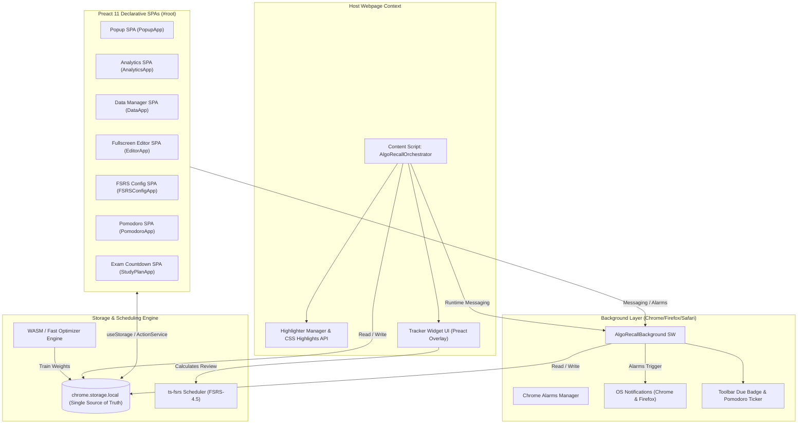

# AlgoRecall: Coding Interview Spaced Repetition Extension

> **AlgoRecall** is a free, local-first browser extension (Manifest V3) designed for coding interview spaced repetition and text highlighting. Built with **Preact 11**, **TypeScript 5**, and Webpack 5, it is powered by the **Free Spaced Repetition Scheduler (FSRS-4.5)** algorithm and WebAssembly (WASM) parameter optimization. It seamlessly tracks problem reviews on LeetCode, AlgoMonster, Codeforces, and other major platforms. Available for **Google Chrome**, **Mozilla Firefox**, and **Apple Safari** (macOS & iOS/iPadOS).

---

## 📖 Technical & Architectural Documentation Index

> 🔗 **Main Documentation Index**: [docs/index.md](./docs/index.md)

The complete architectural layout and table of contents for the codebase documentation suite located in the [docs/](./docs) directory:

```text
docs/
├── architecture/          # High-level MV3 system design, Preact UI architecture, data pipelines, & state distribution
├── features/              # UI feature modules (Tracker, Dashboard, Analytics, Highlighter, Common, Customization, Requirements)
├── scheduler-wasm/        # FSRS algorithm theory, Rating selection guide, WASM optimizer, and performance benchmarks
├── runtime-core/          # Content script orchestrator, background service worker, & types
├── testing/               # Jest, Playwright E2E, mock infrastructure, & artifact isolation audits
└── index.md               # Main Documentation Table of Contents
```

---

## 📑 Detailed Documentation Navigation

### 1. Architecture & System Design
* 📘 [Architecture Overview](./docs/architecture/overview.md) — Multi-tier MV3 cross-browser architecture, 16 Preact single-page applications, service worker lifecycle, and runtime messaging.
* 🔄 [End-to-End Data Pipelines](./docs/architecture/data-flow.md) — Data flow connecting Preact SPAs, Chrome Storage, Background Worker, Content Scripts, and WASM runtime.
* 📦 [State Management Architecture](./docs/architecture/state-management.md) — Separation between Preact component state and persistent storage, custom `useStorage` hook, and reactive storage sync.

### 2. Feature Modules & Developer Guides
* 🎯 [Tracker & Editor](./docs/features/tracker.md) — In-page review overlay, full-screen Markdown notes editor, Big-O complexity inputs, rapid debouncing, and preState snapshots.
* 📊 [Dashboard & Views](./docs/features/dashboard.md) — Preact dashboard suite: Popup, Heatmap, Forecast, Pomodoro timer, Exam Countdown Mode, Summary generator, and History.
* 📈 [Analytics Engine](./docs/features/analytics.md) — Algorithmic memory health, true retention curves, exam readiness forecast, velocity sparklines, confidence bands, and simulation sliders.
* 🖍️ [Highlighter & Options](./docs/features/highlighter.md) — In-page text selection highlighter, CSS Custom Highlights API integration, pure underline rendering, selection preservation, and custom palette editor.
* 🛠️ [Common Utilities & Shared Infrastructure](./docs/features/common.md) — Shared Preact component library (`Toggle`, `useStorage`, `TagChip`), streaming Gzip JSONL `BackupManager`, FNV-1a checksums, Help Center SPA with Privacy Policy, and theme sync.
* ⚙️ [Developer & Customization Guide](./docs/features/customization.md) — Step-by-step recipes for registering new coding platforms, modifying highlighter palettes, adjusting FSRS parameters, and editing CSS variables.
* 📋 [Feature Enhancements Requirements](./docs/features/requirements.md) — Comprehensive feature backlog, requirements matrix (P0–P3), and open design questions.

### 3. FSRS Scheduler & WASM Engine
* 🧮 [FSRS Algorithm & Math](./docs/scheduler-wasm/fsrs-algorithm.md) — Mathematical foundations of FSRS-4.5, initial stability/difficulty formulas, retrievability decay, and state transitions.
* 📖 [FSRS Rating & State Transition Guide](./docs/scheduler-wasm/rating-guide.md) — User and algorithmic guide for rating selection (`Again`, `Hard`, `Good`, `Easy`), state transition matrix, and partial recall strategies.
* ⚡ [WASM & Fast Optimizer](./docs/scheduler-wasm/optimizer-wasm.md) — `@open-spaced-repetition/binding` WASM binding, WASI worker execution, parameter training, and `FsrsOptimizerFast` SGD fallback.
* 🚀 [Performance & Memory](./docs/scheduler-wasm/performance.md) — WASM memory safety bounds, main-thread yielding heuristics, debouncing performance, and benchmark comparisons.

### 4. Runtime Core
* 🖥️ [Content Scripts & DOM Orchestration](./docs/runtime-core/content-scripts.md) — `AlgoRecallOrchestrator`, DOM MutationObserver, SPA client-side history navigation, and `Notifier` alerts.
* ⚙️ [Background Service Worker](./docs/runtime-core/background-service.md) — `AlgoRecallBackground` service worker, `chrome.alarms` setup, quiet hours, push notifications, and background Pomodoro ticker.
* 📐 [Global Types & Utilities](./docs/runtime-core/utils-and-types.md) — Core domain types (`domain.ts`), backup types (`backup.ts`), WASM declarations (`wasm-runtime.d.ts`), and Chrome extension types.

### 5. Testing & Verification
* 🧪 [Test Suite Overview](./docs/testing/test-suite-overview.md) — Jest configuration, Playwright setup, `chromeMock.js` mock environment, and coverage reporters.
* 🔬 [Unit & Component Test Suites](./docs/testing/unit-tests.md) — Comprehensive breakdown of 89 unit/component test modules covering FSRS, `dataUtils`, Preact components, and `backupManager`.
* 🎭 [E2E & Integration Tests](./docs/testing/e2e-integration.md) — Multi-browser Playwright test suite (`test:chrome`, `test:firefox`, `test:safari`) and integration test scenarios.

---

## 🧩 High-Level System Architecture Diagram



---

## 🚀 Quick Start & Development Commands

### Prerequisites
* **Node.js**: v18.0.0 or higher
* **npm**: v9.0.0 or higher

### Installation & Build
```bash
# Clone the repository
git clone https://github.com/sdeanmol/algomonster-fsrs-extension.git
cd algomonster-fsrs-extension

# Install dependencies
npm install

# Build Chrome Extension artifact (→ dist/chrome/ + release/chrome/extension-chrome.zip)
npm run build:chrome

# Build Firefox Extension artifact (→ dist/firefox/ + release/firefox/extension-firefox.zip)
npm run build:firefox

# Build Safari Extension webpack bundle (→ dist/safari/)
# Note: final xcrun packaging requires macOS + Xcode — see below.
npm run build:safari

# Development watch mode
npm run dev:chrome
npm run dev:firefox
npm run dev:safari
```

### Running Test Suites
```bash
# Execute Jest unit & component test suites (90 suites / 1,169 tests)
npm test

# Run cross-browser artifact isolation audit (37 assertions)
npm run check:isolation:all

# Execute Playwright E2E browser tests (Builds Chrome target automatically)
npm run test:e2e
```

### Loading Extension Locally
**For Chrome:**
1. Open Google Chrome and navigate to `chrome://extensions`.
2. Enable **Developer mode** (toggle in upper right corner).
3. Click **Load unpacked** and select the `./dist/chrome` folder.

**For Firefox:**
1. Open Firefox and navigate to `about:debugging#/runtime/this-firefox`.
2. Click **Load Temporary Add-on...**
3. Select the `manifest.json` file inside the `./dist/firefox` folder.

**For Safari (macOS):**
1. Run `npm run build:safari` to produce `dist/safari/`.
2. Run `npm run release:safari` — this calls `xcrun safari-web-extension-packager` and outputs an Xcode project to `release/safari/AlgoRecallSafari/`. *(Requires macOS + Xcode)*
3. Open the generated Xcode project, build it, and run it. Safari will prompt you to enable the extension in **Safari → Settings → Extensions**.
4. Enable the extension and grant requested permissions.

> **Safari distribution note**: Safari Web Extensions are distributed as the containing macOS/iOS app via the App Store. See [Apple's documentation](https://developer.apple.com/documentation/safariservices/safari_web_extensions) for signing and submission steps.

---

## 📄 License & Meta Information

* 🏪 [Chrome Web Store Guide](./CHROMEWEBSTORE.md) — Store listing details, permission justifications, and privacy model.
* 🤖 [Architecture & Agent Rules (`AGENTS.md`)](./AGENTS.md) — Rules for TypeScript compilation, Webpack `CopyPlugin` safety, cross-browser flags, and build gates.
* 📜 [Third Party Licenses](./THIRD_PARTY_LICENSES.md) — Declarations for third-party open source packages (`ts-fsrs`, `marked`, `dompurify`, `preact`).
