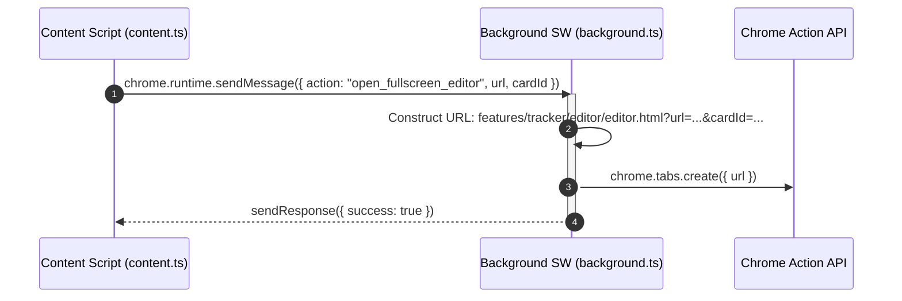
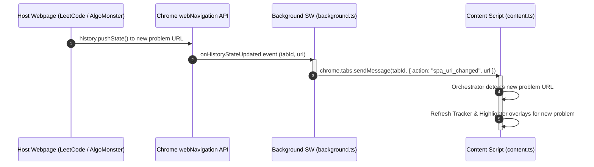

# Communication Architecture & Messaging Protocols

## 1. Overview of Cross-Context Communication

In a browser extension, execution environments (Content Scripts, Service Worker, Popup, and Dashboard Tabs) are strictly isolated by browser process boundaries. Communication between these layers relies on three primary channels:

1. **One-Way & Request-Response Runtime Messaging**: `chrome.runtime.sendMessage` and `chrome.tabs.sendMessage`.
2. **Reactive Storage Events**: `chrome.storage.onChanged` for distributed state synchronization.
3. **Browser Navigation & Alarm Events**: `chrome.webNavigation.onHistoryStateUpdated` and `chrome.alarms.onAlarm`.

---

## 2. Cross-Context Messaging Protocol

### 2.1 The Message Envelope Contract

Defined in [`types/domain.ts`](file:///Users/anmolrastogi/Documents/GitHub/algomonster-fsrs-extension/types/domain.ts):

```typescript
export interface ExtensionMessage {
    type?: MessageType | string;
    action?: MessageType | string;
    payload?: unknown;
    minutes?: number;
    enabled?: boolean;
    url?: string;
    cardId?: string;
    [key: string]: unknown;
}

export interface MessageResponse<T = unknown> {
    success: boolean;
    data?: T;
    error?: string;
    [key: string]: unknown;
}
```

### 2.2 Standard Message Actions (`action` / `type`)

| Action String / Type | Source Context | Target Context | Description | Asynchronous Reply |
|---|---|---|---|---|
| `check_due_cards_now` | Popup / In-Page Widget | Background SW | Requests immediate review check and returns exact due count | Yes (`sendResponse({ success: true, dueCount })`) |
| `test_notification` | Popup / Settings | Background SW | Dispatches test review alert (in-page if active tab whitelisted, else OS notification) | Yes (`sendResponse({ success: true })`) |
| `open_fullscreen_editor` | Content Script Widget | Background SW | Opens `editor.html` in a new browser tab with encoded problem URL and cardId | Yes (`sendResponse({ success: true })`) |
| `snooze_notification` | In-Page Notification | Background SW | Creates `snoozeFsrsReviews` alarm for N minutes (default 15) | Yes (`sendResponse({ success: true })`) |
| `toggle_weekly_summary` | Options / Popup | Background SW | Creates or clears the recurring Monday 9:00 AM weekly summary alarm | Yes (`sendResponse({ success: true })`) |
| `pomodoro_action` | Pomodoro Standalone Tab | Background SW | Starts, pauses, resets, or skips Pomodoro session, controlling ticking interval & badge | Yes (`sendResponse({ success: true })`) |
| `spa_url_changed` | Background SW | Active Tab Content Script | Notifies content script of client-side history navigation (`webNavigation`) | No (One-way broadcast) |
| `show_custom_notification` | Background SW | Active Tab Content Script | Renders in-page DOM toast notification inside the target coding webpage | Yes (`sendResponse({ success: true })`) |

---

## 3. Communication Workflows

### 3.1 Content Script to Background Workflow



### 3.2 SPA Navigation Relay Workflow



---

## 4. Universal Command Service (`ActionService`)

To eliminate duplicate logic across the Popup UI and background keyboard shortcuts, [`ActionService`](file:///Users/anmolrastogi/Documents/GitHub/algomonster-fsrs-extension/features/common/services/actionService.ts) unifies 24 command identifiers:

```typescript
export type CommandActionId =
    | 'check-due-reviews'       // Checks due cards and updates badge
    | 'view-due-cards'          // Opens data.html?view=due
    | 'open-study-plan'         // Opens studyplan.html (Exam Mode)
    | 'toggle-theme'            // Cycles 'dark' <-> 'light' in storage
    | 'open-analytics'          // Opens analytics.html
    | 'open-pomodoro'           // Opens pomodoro.html
    | 'view-all-cards'          // Opens data.html?view=total
    | 'view-retention-cards'    // Opens data.html?view=retention
    | 'open-forecast'           // Opens forecast.html
    | 'open-history'            // Opens history.html
    | 'open-heatmap'            // Opens heatmap.html
    | 'toggle-floating-marker'  // Toggles highlighter marker menu in settings
    | 'open-highlights-manager' // Opens highlights.html
    | 'open-highlights-options' // Opens highlightOptions.html
    | 'toggle-notifications'    // Master toggle for desktop review alerts
    | 'open-summary'            // Opens summary.html
    | 'toggle-algo-launcher'    // Toggles in-page launcher button
    | 'open-websites-manager'   // Opens websites.html (Whitelist)
    | 'open-fsrs-config'        // Opens fsrsConfig.html
    | 'export-backup'           // Triggers NDJSON backup download
    | 'export-anki'             // Triggers Anki TSV file download
    | 'open-help'               // Opens help.html
    | 'open-settings'           // Opens settings.html
    | 'rate-extension';         // Opens browser web store review URL
```

When a user presses a keyboard shortcut (e.g. `Alt+Shift+R` for `'check-due-reviews'` or `Alt+Shift+S` for `'open-study-plan'`), the browser dispatches `chrome.commands.onCommand` to `background.ts`, which delegates directly to `ActionService.executeAction()`.
