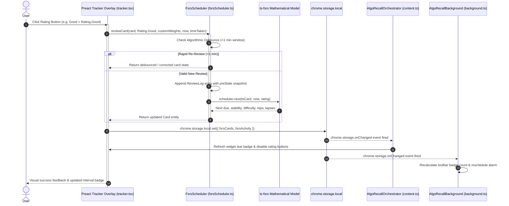
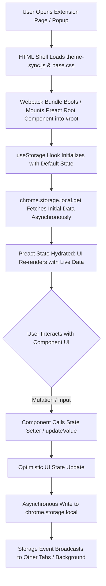
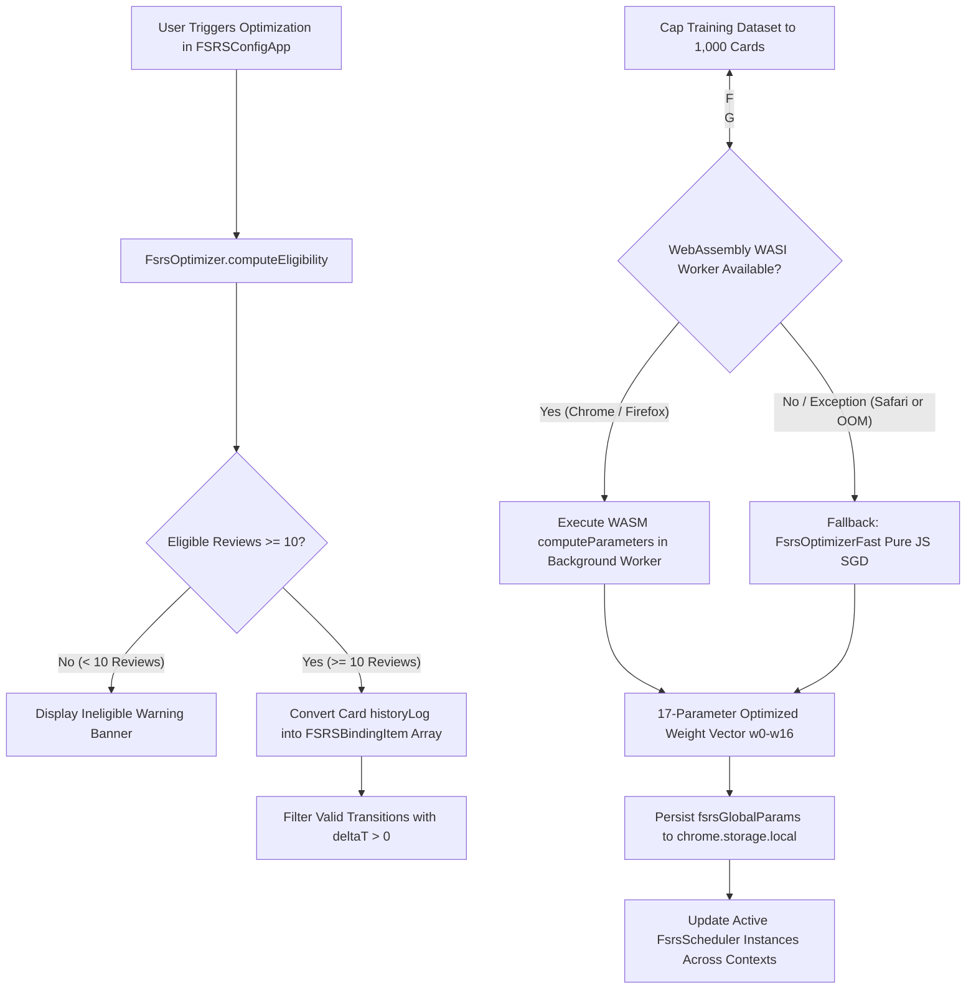
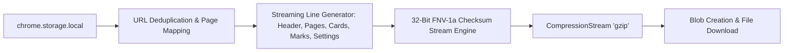
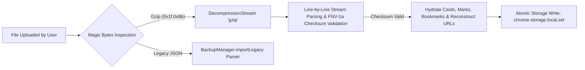
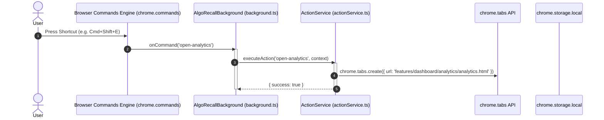

# End-to-End Data Pipelines

This document details the complete data processing pipelines in **AlgoRecall**, tracing how information flows between the Preact UI components, Chrome Storage, Content Scripts, the FSRS Scheduler, the WASM Optimization Engine, and the Background Service Worker.

---

## 🔄 Card Review & Spaced Repetition Data Pipeline

When a user reviews a problem on a whitelisted coding platform (e.g., LeetCode, AlgoMonster, Codeforces), the rating input (`Again`, `Hard`, `Good`, `Easy`) is processed through `FsrsScheduler` and persisted to storage.

---

## 🖥️ Preact Component Data Hydration & Render Pipeline

All 16 extension pages follow a structured hydration and rendering pipeline managed by Preact functional components and custom hooks:

---

## 🧠 WASM & Fallback Parameter Optimization Pipeline

When the user triggers parameter training in `FSRSConfigApp` (`fsrsConfig.tsx`), the extension trains personalized weights using review histories:

---

## 💾 Streaming Gzip JSONL Backup & Restore Pipelines

AlgoRecall features a streaming, memory-efficient backup architecture implemented in [`features/common/data/backupManager.ts`](file:///Users/anmolrastogi/Documents/GitHub/algomonster-fsrs-extension/features/common/data/backupManager.ts).

### 1. Export Pipeline

### 2. Import & Hydration Pipeline

---

## ⌨️ Command Dispatch Pipeline (`ActionService`)

Keyboard shortcut commands (`chrome.commands`) and toolbar action clicks are unified through [`features/common/services/actionService.ts`](file:///Users/anmolrastogi/Documents/GitHub/algomonster-fsrs-extension/features/common/services/actionService.ts):

---

## 🔗 Related Documentation
* 📘 [Architecture Overview](file:///Users/anmolrastogi/Documents/GitHub/algomonster-fsrs-extension/docs/architecture/overview.md)
* 📦 [State Management Architecture](file:///Users/anmolrastogi/Documents/GitHub/algomonster-fsrs-extension/docs/architecture/state-management.md)
* 🧮 [FSRS Mathematical Foundations](file:///Users/anmolrastogi/Documents/GitHub/algomonster-fsrs-extension/docs/scheduler-wasm/fsrs-algorithm.md)
* ⚡ [WASM Optimizer Implementation](file:///Users/anmolrastogi/Documents/GitHub/algomonster-fsrs-extension/docs/scheduler-wasm/optimizer-wasm.md)
