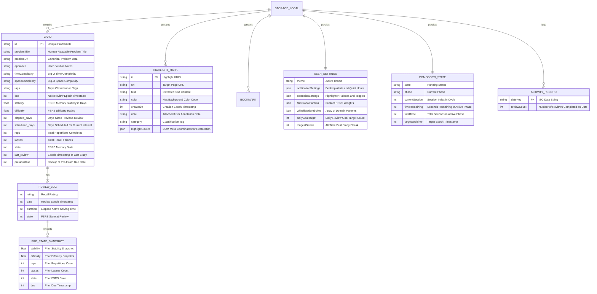
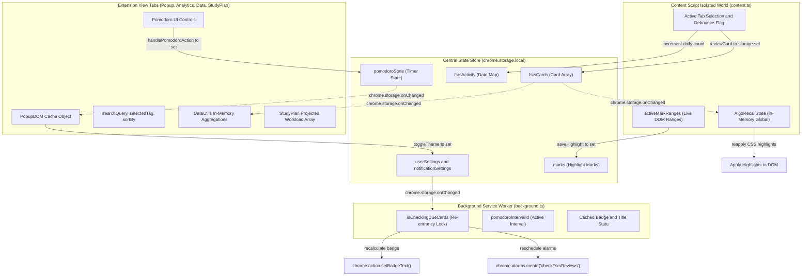

# Data Architecture & State Management Diagrams

This document contains formal Mermaid diagrams illustrating the storage schema, entity relationships, and distributed reactive state management across extension contexts.

---

## 1. Data Architecture & Entity Relationships (Diagram 4)

This diagram details the core data entities stored in `chrome.storage.local`, their structural fields, data types, and relationships.

---

## 2. State Management & Reactivity Architecture (Diagram 5)

This diagram visualizes state ownership, propagation mechanisms, and how distributed extension contexts stay synchronized without polling.

