# Cross-Module Dependency Diagram

This document presents a comprehensive dependency graph of AlgoRecall, detailing how modules import each other, identifying leaf utilities, and tracing architectural layers.

---

## 1. Complete Module Dependency Graph (Diagram 2 Extension)

```mermaid
flowchart TD
    %% Types & Common Base
    subgraph Layer0["Layer 0: Type Definitions (types/)"]
        DOMAIN_TS["types/domain.ts (Core Entities, Enums, Schemas)"]
        BACKUP_TS["types/backup.ts (NDJSON Records & Unions)"]
        WASM_TS["types/wasm-runtime.d.ts (WASI Declarations)"]
        CHROME_TS["types/chrome.d.ts (Browser API Typings)"]
    end

    subgraph Layer1["Layer 1: Foundations & Constants (features/common/)"]
        CONSTANTS["common/constants.ts (Time, Weights, Defaults)"]
        LOGGER["common/logger.ts (Logger Singleton)"]
        BROWSER_CFG["common/browserConfig.ts (Build Target Flags)"]
        CARD_UTILS["common/utils/cardUtils.ts (ID generation, URL cleaning)"]
        UI_UTILS["common/utils/uiUtils.ts (DOM helpers & error catches)"]
        MARKDOWN["common/markdown.ts (DOMPurify Sanitized Renderer)"]
    end

    subgraph Layer2["Layer 2: Core Domain Engines"]
        SCHED_BASE["tracker/scheduler/scheduler.ts (AbstractScheduler Base)"]
        FSRS_SCHED["tracker/scheduler/fsrsScheduler.ts (FSRS Engine & ts-fsrs)"]
        OPT_WASM["tracker/scheduler/fsrsOptimizer.ts (WASI WebAssembly Binding)"]
        OPT_FAST["tracker/scheduler/fsrsOptimizerFast.ts (JS SGD Fallback)"]
        BACKUP_MGR["common/data/backupManager.ts (Streaming NDJSON Engine)"]
        DATA_UTILS["dashboard/analytics/utils/dataUtils.ts (Analytics Statistical Aggregator)"]
    end

    subgraph Layer3["Layer 3: Services & Component Controllers"]
        ACTION_SVC["common/services/actionService.ts (Universal Command Dispatcher)"]
        TAG_INPUT["common/utils/tagInput.ts (Interactive Tag Element)"]
        HL_HELPERS["highlighter/manager/highlights-helpers.ts"]
        POP_STATS["dashboard/popup/stats.ts"]
        POP_HEATMAP["dashboard/popup/heatmap.ts"]
        POP_NOTIF["dashboard/popup/notifications.ts"]
        POP_RATING["dashboard/popup/rating.ts"]
        POP_SEARCH["dashboard/popup/search.ts"]
        SUMM_GEN["dashboard/summary/summaryGenerator.ts"]
    end

    subgraph Layer4["Layer 4: UI View Controllers"]
        TRACKER_UI["tracker/tracker.ts (In-Page Overlay)"]
        EDITOR_UI["tracker/editor/editor.ts (Fullscreen Card Editor)"]
        CONFIG_UI["tracker/config/fsrsConfig.ts (FSRS Parameter Tuner)"]
        HL_CORE["highlighter/highlighter.ts (Selection Manager)"]
        HL_MGR_PAGE["highlighter/manager/highlights.ts"]
        HL_OPT_PAGE["highlighter/options/highlightOptions.ts"]
        POPUP_CTRL["dashboard/popup/popup.ts (Popup Coordinator)"]
        ANA_SPA["dashboard/analytics/analytics.ts (Analytics Master)"]
        STUDYPLAN_CTRL["dashboard/studyplan/studyplan.ts (Exam Mode)"]
        POMO_CTRL["dashboard/pomodoro/pomodoro.ts (Pomodoro UI)"]
        DATA_DASH["common/data/data.ts (Database Table)"]
    end

    subgraph Layer5["Layer 5: Runtime Entry Points"]
        BG_ENTRY["background/background.ts (Service Worker)"]
        CS_ENTRY["content/content.ts (Content Script Orchestrator)"]
    end

    %% Cross-Layer Dependencies
    CONSTANTS --> DOMAIN_TS
    CARD_UTILS --> DOMAIN_TS
    SCHED_BASE --> DOMAIN_TS
    FSRS_SCHED --> DOMAIN_TS
    FSRS_SCHED --> SCHED_BASE
    FSRS_SCHED --> CONSTANTS
    FSRS_SCHED --> CARD_UTILS
    FSRS_SCHED --> LOGGER

    OPT_WASM --> DOMAIN_TS
    OPT_WASM --> CONSTANTS
    OPT_FAST --> DOMAIN_TS
    OPT_FAST --> CONSTANTS

    BACKUP_MGR --> BACKUP_TS
    BACKUP_MGR --> DOMAIN_TS
    BACKUP_MGR --> CONSTANTS
    BACKUP_MGR --> CARD_UTILS
    BACKUP_MGR --> LOGGER

    DATA_UTILS --> DOMAIN_TS
    DATA_UTILS --> CONSTANTS
    DATA_UTILS --> CARD_UTILS
    DATA_UTILS --> SCHED_BASE

    ACTION_SVC --> DOMAIN_TS
    ACTION_SVC --> CONSTANTS
    ACTION_SVC --> BROWSER_CFG
    ACTION_SVC --> BACKUP_MGR

    TRACKER_UI --> DOMAIN_TS
    TRACKER_UI --> FSRS_SCHED
    TRACKER_UI --> CARD_UTILS
    TRACKER_UI --> TAG_INPUT
    TRACKER_UI --> MARKDOWN

    HL_CORE --> DOMAIN_TS
    HL_CORE --> CONSTANTS

    POPUP_CTRL --> ACTION_SVC
    POPUP_CTRL --> POP_STATS
    POPUP_CTRL --> POP_HEATMAP
    POPUP_CTRL --> POP_NOTIF
    POPUP_CTRL --> POP_RATING
    POPUP_CTRL --> POP_SEARCH

    ANA_SPA --> DATA_UTILS
    STUDYPLAN_CTRL --> DOMAIN_TS
    STUDYPLAN_CTRL --> CARD_UTILS
    POMO_CTRL --> DOMAIN_TS
    DATA_DASH --> DOMAIN_TS
    DATA_DASH --> CARD_UTILS
    DATA_DASH --> TAG_INPUT

    BG_ENTRY --> DOMAIN_TS
    BG_ENTRY --> CONSTANTS
    BG_ENTRY --> BROWSER_CFG
    BG_ENTRY --> ACTION_SVC

    CS_ENTRY --> DOMAIN_TS
    CS_ENTRY --> TRACKER_UI
    CS_ENTRY --> HL_CORE
```

