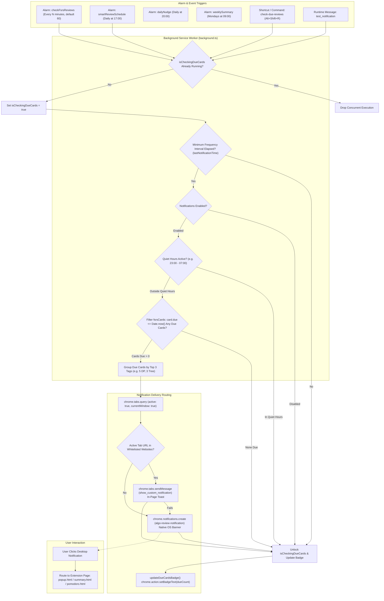

# Notification & Background Scheduling Flow Diagram

This document contains formal Mermaid diagrams illustrating the notification scheduling, alarm triggers, quiet hours suppression, and dispatch routing implemented in [`background/background.ts`](file:///Users/anmolrastogi/Documents/GitHub/algomonster-fsrs-extension/background/background.ts).

---

## 1. Notification Architecture & Dispatch Flow (Diagram 8)

The following diagram maps out how background alarms trigger review checks, how quiet hours and frequency throttling are evaluated, and how notifications are routed between in-page DOM toasts and OS system tray banners.

---

## 2. Weekly Digest & Daily Streak Nudge Workflows

### 2.1 Weekly Summary Digest (Mondays 9:00 AM)
1. **Alarm Trigger**: `weeklySummary` fires every Monday at 9:00 AM local time.
2. **Aggregation**:
   - Queries `fsrsActivity` across the last 7 calendar days to compute total reviews and active study days.
   - Queries previous 7-day window to compute week-over-week trend (`📈 +15 vs last week`).
   - Scans `fsrsCards` to forecast upcoming load: cards due in the next 7 days (`due <= now + 7 days`).
3. **Notification Output**:
   Dispatches notification: `"This week: 42 reviews across 5 day(s). 📈 +12 vs last week. Upcoming: 18 cards due next week."`

### 2.2 Daily Streak Nudge (Daily at 20:00)
1. **Alarm Trigger**: `dailyNudge` fires daily at 8:00 PM local time.
2. **Streak Verification**:
   - Checks `fsrsActivity[today]`. If reviews > 0, skips notification (goal met).
   - If reviews === 0, inspects `fsrsActivity[yesterday]` to check if an active streak is at risk.
3. **Notification Content**:
   - **Active Streak at Risk**: `"🔥 Keep Your Streak Alive! You haven't reviewed any patterns today. Just 5 minutes can keep your memory sharp!"`
   - **No Active Streak**: `"🚀 Start a New Streak Today! Every expert was once a beginner. Start fresh with just 5 minutes of review!"`
