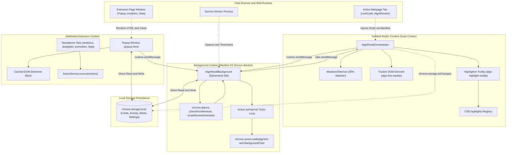

# Browser Extension Runtime Architecture & Lifecycle Sequence Diagrams

This document contains formal Mermaid diagrams illustrating the Manifest V3 runtime architecture, lifecycle boundaries, and the complete interactive review lifecycle sequence.

---

## 1. Browser Extension Runtime Architecture (Diagram 3)

The following diagram maps out how the extension boots across multiple isolated execution contexts, the lifecycle boundaries between them, and how storage reactivity synchronizes state.



---

## 2. Review Lifecycle Sequence Diagram (Diagram 6)

This sequence diagram traces the complete end-to-end workflow when a user reviews an algorithmic problem card, from user input to FSRS calculation, rapid re-review debouncing, storage persistence, and reactive UI updates.

```mermaid
sequenceDiagram
    autonumber
    actor User as "User / Learner"
    participant UI as "Tracker Widget / Popup UI"
    participant Sched as "FsrsScheduler"
    participant tsFsrs as "ts-fsrs Core Library"
    participant Storage as "chrome.storage.local"
    participant SW as "Background Service Worker"
    participant Badge as "Chrome Action Badge"

    User->>UI: Clicks Rating Button or Presses Hotkey (1: Again, 2: Hard, 3: Good, 4: Easy)
    activate UI
    UI->>UI: Triggers UI debounce guard (RATING_UI_DEBOUNCE_MS: 400ms)
    UI->>Sched: reviewCard(card, rating, customWeights, now, duration)
    deactivate UI
    
    activate Sched
    Sched->>Sched: Retrieve lastReview timestamp via getLastReviewDate(card)
    
    alt Case 1: Rapid Re-Review Duplicate Rating (Debounce)
        Sched->>Sched: Suppress recalculation; accumulate duration into existing log entry
        Sched-->>UI: Return card with updated log duration
    else Case 2: Rapid Re-Review Corrected Rating (Rollback)
        Sched->>Sched: Pop previous log entry; restore metrics from stored preState snapshot
        Sched->>Sched: Re-run reviewCard() using restored preState and new rating
    else Case 3: Standard Review Calculation
        Sched->>Sched: Create new ReviewLog entry with preState snapshot of current card
        Sched->>Sched: Instantiate ts-fsrs instance with 17-parameter weights (w)
        Sched->>tsFsrs: scheduler.next(tsCard, new Date(now), rating)
        activate tsFsrs
        tsFsrs-->>Sched: Updated TsFsrsCard (due, stability, difficulty, reps, lapses, state)
        deactivate tsFsrs
        Sched->>Sched: Assemble updated Card entity with recalculated metrics
        Sched-->>UI: Return updated Card
    end
    deactivate Sched

    activate UI
    UI->>Storage: chrome.storage.local.get(['fsrsCards', 'fsrsActivity'])
    Storage-->>UI: Current cards and activity map
    UI->>Storage: chrome.storage.local.set({ fsrsCards: updatedCards, fsrsActivity: updatedActivity })
    UI->>UI: Display visual feedback banner ("Next review in X days")
    deactivate UI

    activate Storage
    Storage-->>SW: Fires chrome.storage.onChanged event ({ fsrsCards, fsrsActivity })
    deactivate Storage

    activate SW
    SW->>SW: handleStorageChanged() detects fsrsCards mutation
    SW->>SW: updateDueCardsBadge()
    SW->>Storage: Filter cards where card.due <= Date.now()
    Storage-->>SW: Remaining due count
    SW->>Badge: chrome.action.setBadgeText({ text: String(dueCount) })
    SW->>Badge: chrome.action.setBadgeBackgroundColor({ color: '#1a73e8' })
    deactivate SW
```
