# System Overview & Module Architecture Diagrams

This document contains authoritative Mermaid architectural diagrams representing the high-level system topology and repository module decomposition of AlgoRecall.

---

## 1. High-Level System Architecture (Diagram 1)

The following diagram illustrates the interaction between the host browser, user UI contexts, the Manifest V3 background service worker, injected content scripts, local storage, browser APIs, and external integration exports.

```mermaid
flowchart TB
    subgraph HostDOM["Host Webpage DOM Context (LeetCode, AlgoMonster)"]
        DOM["Target Problem Webpage"]
        CS["content.js (AlgoRecallOrchestrator)"]
        TR["Tracker Widget UI (algo-fsrs-tracker)"]
        HL["Highlighter Manager (CSS Custom Highlights)"]
        NOTIF_IN["In-Page Toast Alert (algo-in-page-alert)"]
        
        DOM --- CS
        CS --> TR
        CS --> HL
        CS --> NOTIF_IN
    end

    subgraph BackgroundWorker["Background Service Worker Context (Manifest V3)"]
        SW["background.js (AlgoRecallBackground)"]
        ALM["Alarm Manager (chrome.alarms)"]
        NOTIF_SYS["System Desktop Notifications (chrome.notifications)"]
        BADGE["Action Badge and Icon Manager (chrome.action)"]
        CMD["Command Dispatcher (chrome.commands)"]
        NAV["Navigation Listener (chrome.webNavigation)"]
        
        SW --> ALM
        ALM --> SW
        SW --> NOTIF_SYS
        SW --> BADGE
        SW --> CMD
        CMD --> SW
        SW --> NAV
        NAV --> SW
    end

    subgraph ExtensionPages["Dedicated Extension UI Contexts (chrome-extension://)"]
        POP["Popup Dashboard (popup.html)"]
        ANA["Analytics SPA (analytics.html)"]
        EDT["Fullscreen Editor (editor.html)"]
        EXAM["Exam Countdown Mode (studyplan.html)"]
        POMO["Pomodoro Timer (pomodoro.html)"]
        DATA["Data and Bulk Management (data.html)"]
        SETT["Settings and Help Center (settings.html / help.html)"]
    end

    subgraph StorageLayer["Browser Storage & Runtime Engine"]
        LOCAL_STORE[("chrome.storage.local")]
        FSRS_ENGINE["ts-fsrs Scheduler Engine"]
        WASM_OPT["WASI Optimizer Worker (@open-spaced-repetition)"]
    end

    subgraph ExternalIntegrations["External Exports & Exchanges"]
        ANKI_FILE["Anki TSV / TXT Flashcard Deck"]
        BACKUP_FILE["Gzip NDJSON Backup Archive (.json.gz)"]
    end

    %% Communication Channels
    CS -->|runtime.sendMessage| SW
    SW -->|tabs.sendMessage| CS
    CS -.->|chrome.storage.onChanged| LOCAL_STORE
    SW <-->|Read and Write Storage| LOCAL_STORE
    
    POP <-->|Read and Write Storage| LOCAL_STORE
    ANA <-->|Read and Write Storage| LOCAL_STORE
    DATA <-->|Read and Write Storage| LOCAL_STORE
    EDT <-->|Read and Write Storage| LOCAL_STORE

    POP -->|runtime.sendMessage| SW
    DATA -->|runtime.sendMessage| SW
    
    TR -->|Calculate Next Intervals| FSRS_ENGINE
    ANA -->|Evaluate Mathematical Metrics| FSRS_ENGINE
    SETT -->|Train Personalized Weights| WASM_OPT
    WASM_OPT -->|Save 17 Weights| LOCAL_STORE
    
    DATA -->|Export and Import| ANKI_FILE
    DATA -->|Streaming Backup and Restore| BACKUP_FILE
    SETT -->|Export and Import| ANKI_FILE
```

---

## 2. Repository & Module Architecture (Diagram 2)

This diagram visualizes the modular layout of the codebase, module responsibilities, and structural hierarchy.

```mermaid
flowchart TD
    subgraph TypesConstants["Foundations and Types"]
        TYPES["types/ (domain.ts, backup.ts, wasm-runtime.d.ts)"]
        CONSTANTS["features/common/constants.ts (Defaults, Intervals, Limits)"]
        LOGGER["features/common/logger.ts (Logger and Perf Timers)"]
        CONFIG["features/common/browserConfig.ts (Compile-Time Feature Flags)"]
    end

    subgraph CoreRuntime["Core Execution Contexts"]
        BG_MOD["background/background.ts (Alarms, Notifications, Badge Ticking)"]
        CS_MOD["content/content.ts (Orchestrator and DOM MutationObserver)"]
        STATE_MOD["content/state.ts (Shared In-Memory State Slices)"]
        NOTIF_MOD["content/notifications.ts (In-Page DOM Toast Alerts)"]
    end

    subgraph TrackerModule["features/tracker/ (Spaced Repetition & Reviews)"]
        TR_UI["tracker.ts (Floating Review Widget and Hotkeys)"]
        SCHED["scheduler/fsrsScheduler.ts (FSRS v4.5 Math and Debouncing)"]
        OPT_WASM["scheduler/fsrsOptimizer.ts (WASI WebAssembly Weight Training)"]
        OPT_FAST["scheduler/fsrsOptimizerFast.ts (Pure JS Heuristic SGD Fallback)"]
        EDITOR["editor/editor.ts (Fullscreen Markdown Problem Editor)"]
        FSRS_CFG["config/fsrsConfig.ts (17-Weight Parameter Tuner)"]
    end

    subgraph DashboardModule["features/dashboard/ (Views & Standalone Pages)"]
        POP_UI["popup/popup.ts (Action Popup Coordinator)"]
        ANA_SPA["analytics/analytics.ts (7-Tab Statistical Analytics SPA)"]
        STUDY_PLAN["studyplan/studyplan.ts (Exam Mode Redistribution Controller)"]
        POMO_UI["pomodoro/pomodoro.ts (SVG Timer and Phase Controller)"]
        HEATMAP_UI["heatmap/heatmap.ts (Contribution Grid and Streaks)"]
        FORECAST_UI["forecast/forecast.ts (30-Day Upcoming Workload Chart)"]
        HIST_UI["history/history.ts (Historical Review Logs Viewer)"]
        SUMM_UI["summary/summary.ts (Weekly and Monthly Digest Generator)"]
    end

    subgraph HighlighterModule["features/highlighter/ (Text Annotations)"]
        HL_CORE["highlighter.ts (Selection Tooltip and CSS Highlights)"]
        HL_MGR["manager/highlights.ts (Saved Annotations Table and Search)"]
        HL_OPT["options/highlightOptions.ts (Palettes and Symbol Config)"]
    end

    subgraph CommonServices["features/common/ (Shared Services & Hubs)"]
        ACTION_SVC["services/actionService.ts (Universal 24-Command Dispatcher)"]
        BACKUP_MGR["data/backupManager.ts (Streaming Gzip NDJSON Engine)"]
        DATA_DASH["data/data.ts (Filterable Problem Database Table)"]
        SETTINGS_PAGE["settings/settings.ts (Data, Anki, and Extension Settings)"]
        HELP_PAGE["help/help.ts (Help Center SPA and Privacy Policy)"]
        WEBSITES_PAGE["websites/websites.ts (Platform Domain Whitelist Manager)"]
        WELCOME_PAGE["welcome/welcome.ts (Onboarding Walkthrough Flow)"]
    end

    %% Dependencies
    CoreRuntime --> TYPES
    TrackerModule --> TYPES
    DashboardModule --> TYPES
    CommonServices --> TYPES

    TrackerModule --> CONSTANTS
    DashboardModule --> CONSTANTS
    CommonServices --> CONSTANTS

    TR_UI --> SCHED
    SCHED --> CONSTANTS
    FSRS_CFG --> OPT_WASM
    FSRS_CFG --> OPT_FAST
    
    CS_MOD --> TR_UI
    CS_MOD --> HL_CORE
    CS_MOD --> NOTIF_MOD
    
    BG_MOD --> ACTION_SVC
    POP_UI --> ACTION_SVC
    SETTINGS_PAGE --> ACTION_SVC
    
    ACTION_SVC --> BACKUP_MGR
    DATA_DASH --> BACKUP_MGR
```

