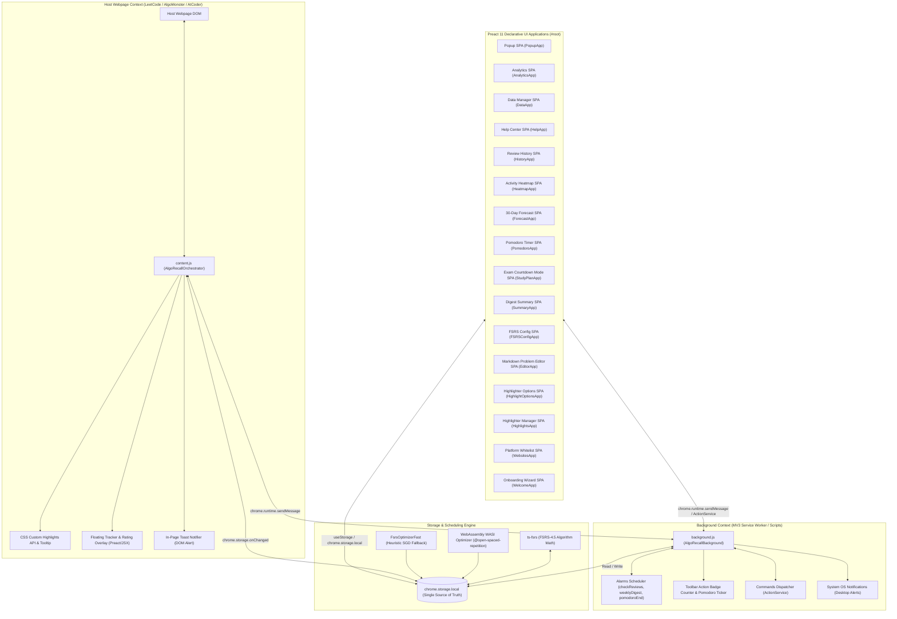
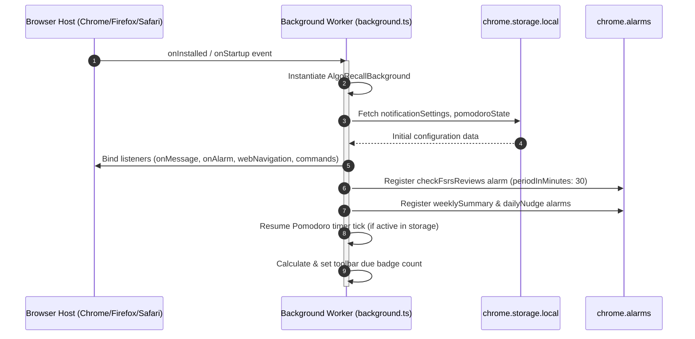

# Architecture Overview

This document provides a comprehensive technical overview of **AlgoRecall**, a modern Manifest V3 cross-browser extension built with **Preact 11**, **TypeScript 5**, and **Webpack 5**. It details the multi-tier system architecture, Preact component-driven UI applications, cross-browser compatibility layers (Chrome, Firefox, Safari), runtime messaging interfaces, background service worker lifecycle, and content script injection models.

---

## 🏛️ System Architecture

AlgoRecall adheres to a modular, decoupled 4-tier architecture spanning multiple browser extension execution contexts:

1. **Background Layer**: 
   - Event-driven background service worker (Chrome & Safari MV3) / persistent background scripts (Firefox MV3) orchestrating alarms, desktop push notifications, browser toolbar badges, Pomodoro background countdown, and keyboard command routing (`chrome.commands`).
2. **Content Script Layer**: 
   - Isolated in-page script (`AlgoRecallOrchestrator`) injected into whitelisted coding platforms (LeetCode, AlgoMonster, Codeforces, etc.). Manages the non-invasive CSS Custom Highlights API, DOM MutationObserver debouncing, and in-page floating study widgets.
3. **Preact Component-Driven UI Layer**: 
   - 16 modular, standalone single-page applications (SPAs) authored in Preact 11 (`.tsx`) that mount declaratively to minimal HTML entry shells (`#root`). Each application features reactive two-way storage synchronization, accessible UI components, and TypeScript prop interfaces.
4. **Storage & Mathematical Engine Layer**: 
   - Local-first persistence using `chrome.storage.local` coupled with the **Free Spaced Repetition Scheduler (FSRS-4.5)** engine (`ts-fsrs`), WebAssembly (WASI) parameter optimizer (`@open-spaced-repetition/binding`), and pure JavaScript SGD fallback.



---

## ⚛️ Preact Component Architecture & SPA Entry Points

All user-facing extension pages have been authored using Preact functional components and JSX, replacing legacy imperative DOM manipulation with declarative, reactive component trees.

### 1. Mounting Mechanism
Each extension page has a minimal HTML entry file containing only external stylesheets, theme bootstrap script (`features/common/theme-sync.js`), and a target mount anchor:
```html
<body>
    <div id="root"></div>
    <script type="module" src="popup.js"></script>
</body>
```

At bundle bootstrap, each application detects `#root` and renders its root Preact component tree:
```tsx
import { h, render } from 'preact';
import { PopupApp } from './popup';

const root = document.getElementById('root');
if (root) {
    render(<PopupApp />, root);
}
```

### 2. Dual-Mode Compatibility (Graceful Fallback)
For legacy unit test runners or environments where `#root` is not present, entry points provide graceful degradation:
```tsx
if (typeof document !== 'undefined') {
    const root = document.getElementById('root');
    if (root) {
        render(<PopupApp />, root);
    } else {
        // Fallback for isolated legacy unit test assertions
        new AlgoRecallDashboard();
    }
}
```

### 3. Inventory of Preact Applications

| Application | Entry HTML | Preact Root Component | Description |
| :--- | :--- | :--- | :--- |
| **Popup** | `features/dashboard/popup/popup.html` | `<PopupApp />` | Main toolbar popup: KPI cards, goal ring, heatmap, search, launchers. |
| **Analytics** | `features/dashboard/analytics/analytics.html` | `<AnalyticsApp />` | 7-tab deep analytics SPA: retention, readiness, tags, velocity, simulation. |
| **Data Manager** | `features/common/data/data.html` | `<DataApp />` | Full problem pattern table, column sorting, filters, bulk edits, NDJSON. |
| **Help Center** | `features/common/help/help.html` | `<HelpApp />` | Documentation SPA, FAQ guides, interactive tabs, Privacy Policy. |
| **Forecast** | `features/dashboard/forecast/forecast.html` | `<ForecastApp />` | 30-day review workload projections, calendar grid, daily bar charts. |
| **Heatmap** | `features/dashboard/heatmap/heatmap.html` | `<HeatmapApp />` | Fullscreen 365-day contribution heatmap, filter cascades, streak stats. |
| **History** | `features/dashboard/history/history.html` | `<HistoryApp />` | Chronological review logs, year/month/day drill-down, activity bars. |
| **Pomodoro** | `features/dashboard/pomodoro/pomodoro.html` | `<PomodoroApp />` | Focus timer dial, background service worker sync, session counters. |
| **Exam Mode** | `features/dashboard/studyplan/studyplan.html` | `<StudyPlanApp />` | Exam Countdown Mode, quota redistribution, SVG countdown ring. |
| **Summary** | `features/dashboard/summary/summary.html` | `<SummaryApp />` | Weekly & monthly performance digests, smart advice, mastery bars. |
| **FSRS Config** | `features/tracker/config/fsrsConfig.html` | `<FSRSConfigApp />` | 17-parameter weights tuning, retention presets, WASM optimizer trigger. |
| **Notes Editor** | `features/tracker/editor/editor.html` | `<EditorApp />` | Markdown solution notes editor, Big-O complexity inputs, live preview. |
| **Highlight Manager** | `features/highlighter/manager/highlights.html` | `<HighlightsApp />` | Saved quotes manager, color filtering, clipboard copy, delete actions. |
| **Highlight Options** | `features/highlighter/options/highlightOptions.html` | `<HighlightOptionsApp />` | Custom 5-color palette designer, active slot picker, default color. |
| **Websites Manager** | `features/common/websites/websites.html` | `<WebsitesApp />` | Platform domain whitelist, dynamic host permissions, content script registration. |
| **Onboarding Wizard**| `features/common/welcome/welcome.html` | `<WelcomeApp />` | 4-step first-run wizard: FSRS intro, theme select, notification setup. |

---

## 🌐 Cross-Browser Architectural Layer (Chrome, Firefox, Safari)

AlgoRecall targets Chrome, Firefox, and Safari using a unified TypeScript source tree and compile-time target specialization.

### 1. Build-Time Target Injection (`webpack.config.js`)
Webpack uses `DefinePlugin` to inject browser flags and store metadata at compile time without runtime polyfill overhead:
```typescript
new webpack.DefinePlugin({
    __BROWSER_TARGET__: JSON.stringify(target),       // 'chrome' | 'firefox' | 'safari'
    __STORE_NAME__: JSON.stringify(storeName),
    __STORE_REVIEW_URL__: JSON.stringify(storeReviewUrl)
})
```

### 2. Browser Capabilities Feature Matrix (`features/common/browserConfig.ts`)

```typescript
export interface BrowserConfig {
    target: 'chrome' | 'firefox' | 'safari';
    displayName: string;
    storeName: string;
    reviewUrl: string;
    supportsNotifications: boolean;  // false on Safari
    supportsAlarms: boolean;         // true across all targets
    supportsDownloads: boolean;      // false on Safari
}
```

| Architectural Dimension | Google Chrome | Mozilla Firefox | Apple Safari |
| :--- | :--- | :--- | :--- |
| **Manifest Version** | Manifest V3 | Manifest V3 | Manifest V3 |
| **Background Model** | `service_worker` (`background/background.ts`) | `background.scripts` (MV3 Background Script) | `service_worker` (Safari 15.4+ MV3) |
| **Gecko ID Block** | None | Required (`browser_specific_settings.gecko`) | None |
| **Notifications** | `chrome.notifications` supported | `chrome.notifications` supported | **Unsupported** (`supportsNotifications: false`) |
| **Alarms API** | `chrome.alarms` supported | `chrome.alarms` supported | `chrome.alarms` supported (Safari 14+) |
| **Downloads API** | `chrome.downloads` supported | `chrome.downloads` supported | **Unsupported** (Fallback anchor download) |
| **WASM Runtime** | Node/Browser WASI Worker | Node/Browser WASI Worker | Pure JS fallback (`FsrsOptimizerFast`) |
| **Release Packaging**| `.zip` archive for Web Store | `.zip` archive for AMO | Xcode project via `safari-web-extension-packager` |

---

## ⚙️ Manifest V3 & Service Worker Lifecycle

In Manifest V3, background workers are ephemeral: they start upon incoming Chrome events, execute async routines, and sleep when idle.

### Key Constraints & Solutions
* **No Window / DOM**: Background code cannot touch `document` or `window`. All DOM operations are confined to Preact SPAs or content script overlays.
* **Ephemeral Memory**: In-memory variables are wiped when the worker sleeps. All persistent state is saved directly in `chrome.storage.local`.
* **Alarm-Driven Wakeup**: Background operations (due review checks, Pomodoro timer completion, weekly summary generation) are registered as `chrome.alarms`.
* **Cross-Context Commands**: The background worker registers `chrome.commands.onCommand` shortcuts and delegates execution to `ActionService`.



---

## 📡 Extension Context Messaging Architecture

Communication between Content Scripts, Preact SPAs, and the Background Service Worker uses standardized messaging contracts:

```typescript
export interface ExtensionMessage {
    type?: MessageType | string;
    action?: MessageType | string;
    payload?: unknown;
    cardId?: string;
    minutes?: number;
    enabled?: boolean;
    command?: string;
    state?: PomodoroState;
    [key: string]: unknown;
}

export interface MessageResponse<T = unknown> {
    success: boolean;
    data?: T;
    error?: string;
    handledInPage?: boolean;
}
```

### Supported Runtime Messaging Actions

| Action Identifier | Source Context | Target Context | Description |
| :--- | :--- | :--- | :--- |
| `check_due_cards_now` | Popup / Keyboard | Background | Forces immediate due review re-check and updates action badge. |
| `test_notification` | Popup / Options | Content / Background | Dispatches test review reminder to active tab or OS notification tray. |
| `snooze_notification`| Content Script Toast | Background | Sets a 15-minute temporary snooze alarm for review alerts. |
| `open_fullscreen_editor`| Content Widget | Background | Opens `editor.html` in a new tab with problem metadata. |
| `toggle_weekly_summary`| Popup / Settings | Background | Creates or clears the recurring Monday morning summary alarm. |
| `test_summary_notification`| Summary SPA | Background | Tests dispatch of weekly performance recap notification. |
| `pomodoro_action` | Pomodoro SPA | Background | Coordinates timer commands (`start`, `pause`, `reset`, `skip`). |

---

## 🔗 Related Documentation
* 📊 [End-to-End Data Pipelines](file:///Users/anmolrastogi/Documents/GitHub/algomonster-fsrs-extension/docs/architecture/data-flow.md)
* 📦 [State Management Architecture](file:///Users/anmolrastogi/Documents/GitHub/algomonster-fsrs-extension/docs/architecture/state-management.md)
* 🧮 [FSRS Algorithm Math & Mechanics](file:///Users/anmolrastogi/Documents/GitHub/algomonster-fsrs-extension/docs/scheduler-wasm/fsrs-algorithm.md)
* 📖 [FSRS Rating & State Guide](file:///Users/anmolrastogi/Documents/GitHub/algomonster-fsrs-extension/docs/scheduler-wasm/rating-guide.md)
* 🛠️ [Developer Customization Guide](file:///Users/anmolrastogi/Documents/GitHub/algomonster-fsrs-extension/docs/features/customization.md)
