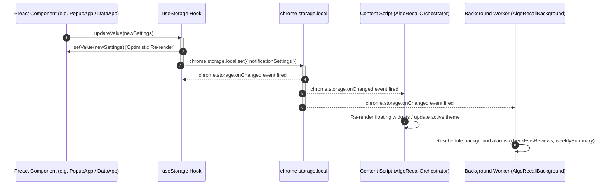

# State Management Architecture

This document describes how state is managed, distributed, and synchronized across extension execution contexts in **AlgoRecall**. It details the separation between **Preact component state** and **persistent extension storage**, the reactive `useStorage` custom hook, `chrome.storage.local` schemas, and cross-context reactivity via `chrome.storage.onChanged`.

---

## 🗄️ Architecture: Separation of State Concerns

In a Manifest V3 browser extension built with Preact, state management spans three distinct architectural boundaries:

```mermaid
graph TD
    subgraph Preact_Component_Tree ["1. Preact Component State (In-Memory / Reactivity)"]
        HOOKS["Hooks: useState, useMemo, useCallback, useRef"]
        CUSTOM_HOOK["Custom Hook: useStorage<T>(key, defaultValue)"]
        PROPS["Unidirectional Props Distribution (Parent -> Child)"]
        HOOKS --> PROPS
        CUSTOM_HOOK --> HOOKS
    end

    subgraph Browser_Storage ["2. Persistent Extension Storage (Single Source of Truth)"]
        LOCAL[("chrome.storage.local (Permanent Domain Models & Config)")]
        ON_CHANGED["chrome.storage.onChanged Event Broadcaster"]
        LOCAL --> ON_CHANGED
    end

    subgraph Extension_Contexts ["3. Non-Preact Execution Contexts"]
        BG_MEM["Background Service Worker Memory (Ephemeral State)"]
        CONTENT_MEM["Content Script Memory: window.AlgoRecall.state"]
    end

    CUSTOM_HOOK <-->|"Async Get / Set"| LOCAL
    ON_CHANGED -->|"Automatic Re-render"| CUSTOM_HOOK
    BG_MEM <-->|"Read / Write"| LOCAL
    CONTENT_MEM <-->|"Read / Write"| LOCAL
    ON_CHANGED -->|"Event Listener"| BG_MEM
    ON_CHANGED -->|"Event Listener"| CONTENT_MEM
```

---

## ⚛️ Preact Reactive State & The `useStorage` Hook

To prevent state drift between Preact components and `chrome.storage.local`, AlgoRecall utilizes a custom reactive hook: [`features/common/ui/hooks/useStorage.ts`](file:///Users/anmolrastogi/Documents/GitHub/algomonster-fsrs-extension/features/common/ui/hooks/useStorage.ts).

### Hook Contract & Synchronization Mechanism

```typescript
export function useStorage<T>(
    key: string,
    defaultValue: T
): [T, (newValue: T | ((prev: T) => T)) => Promise<void>, boolean] {
    const [value, setValue] = useState<T>(defaultValue);
    const [loading, setLoading] = useState<boolean>(true);

    // 1. Initial fetch from chrome.storage.local
    useEffect(() => {
        let isMounted = true;
        chrome.storage.local.get([key], (result) => {
            if (isMounted && result && result[key] !== undefined) {
                setValue(result[key] as T);
            }
            if (isMounted) setLoading(false);
        });

        // 2. React to external changes from other tabs or background worker
        const handleStorageChange = (changes: { [k: string]: chrome.storage.StorageChange }, area: string) => {
            if (area === 'local' && changes[key] && isMounted) {
                setValue(changes[key].newValue as T);
            }
        };

        chrome.storage.onChanged.addListener(handleStorageChange);
        return () => {
            isMounted = false;
            chrome.storage.onChanged.removeListener(handleStorageChange);
        };
    }, [key]);

    // 3. Setter function that atomically persists to chrome.storage.local
    const updateValue = useCallback(async (newValueOrUpdater: T | ((prev: T) => T)): Promise<void> => {
        let resolvedValue: T;
        if (typeof newValueOrUpdater === 'function') {
            const currentData = await chrome.storage.local.get([key]);
            const currentVal = currentData?.[key] !== undefined ? currentData[key] : value;
            resolvedValue = (newValueOrUpdater as (prev: T) => T)(currentVal);
        } else {
            resolvedValue = newValueOrUpdater;
        }
        setValue(resolvedValue);
        await chrome.storage.local.set({ [key]: resolvedValue });
    }, [key, value]);

    return [value, updateValue, loading];
}
```

### Architectural Benefits of `useStorage`
1. **Zero State Drift**: UI components always reflect the latest storage values, even when modified by background alarms or other tabs.
2. **Optimistic UI Updates**: Local Preact state updates immediately (`setValue(resolvedValue)`), followed by asynchronous persistence.
3. **Stale Closure Protection**: Updater functions `(prev => next)` fetch the latest storage state to prevent race conditions during rapid state transitions.
4. **Automatic Resource Cleanup**: Event listeners are unregistered upon component unmount, preventing memory leaks.

---

## 🗄️ Domain Storage Schema (`types/domain.ts`)

`chrome.storage.local` holds all persistent domain models, configuration objects, and study logs.

```typescript
export interface StorageData {
    /** Tracked algorithmic flashcards with FSRS stability, difficulty, and review history */
    fsrsCards?: Card[];
    /** Daily review count activity map: { [isoDate "YYYY-MM-DD"]: count } */
    fsrsActivity?: { [date: string]: number };
    /** Custom per-topic FSRS weight multipliers: { [topicTag]: number[] } */
    fsrsTopicWeights?: { [topic: string]: number[] };
    /** Global personalized FSRS-4.5 algorithm weights and target retention */
    fsrsGlobalParams?: FSRSParameters | Partial<FSRSParameters>;
    /** Desktop and in-page notification preferences and check intervals */
    notificationSettings?: NotificationSettings;
    /** Whitelisted website domains where content scripts are active */
    whitelistedWebsites?: WhitelistedWebsite[];
    /** General UI preferences (palette selections, launcher toggle, marker toggle) */
    extensionSettings?: ExtensionSettings;
    /** Active visual theme ('dark' | 'light') */
    theme?: string;
    /** Persisted text highlight mark annotations across web pages */
    marks?: HighlightMark[];
    /** Saved problem page bookmarks */
    bookmarks?: BookmarkItem[];
    /** Live Pomodoro timer status ('idle' | 'running' | 'paused') and target timestamp */
    pomodoroState?: PomodoroState;
    /** Pomodoro session duration preferences (focus, short break, long break) */
    pomodoroSettings?: PomodoroSettings;
    /** Pomodoro study statistics (daily session counts, total focus minutes) */
    pomodoroStats?: PomodoroStats;
    /** User study plan and exam countdown deadline configuration */
    studyPlanSettings?: StudyPlanSettings;
}
```

---

## 🔄 Multi-Context Data Synchronization Flow

Because extension execution contexts run in separate JavaScript runtimes, state mutations must propagate reliably.



---

## ⚡ State Lifecycle Comparison Matrix

| State Type | Execution Scope | Lifecycle | Storage Mechanism | Reactivity Trigger |
| :--- | :--- | :--- | :--- | :--- |
| **Component Local** | Individual Preact Component | Lifetime of mounted component | In-memory `useState` / `useRef` | State setter calls |
| **Component Shared** | Preact Component Tree | Prop-drilled across views | Preact Props interfaces | Parent re-render |
| **Storage-Backed Reactive** | Preact SPAs (`popup`, `data`, etc.) | Permanent across browser restarts | `useStorage` + `chrome.storage.local` | `chrome.storage.onChanged` |
| **Content In-Memory** | Content Script Tab | Tab page lifetime | `window.AlgoRecall.state` | DOM events, MutationObserver |
| **Background Ephemeral**| Service Worker | Ephemeral (terminated when idle) | Restored on demand from `chrome.storage.local` | Alarm / Message wakeups |

---

## 🔗 Related Documentation
* 📘 [Architecture Overview](file:///Users/anmolrastogi/Documents/GitHub/algomonster-fsrs-extension/docs/architecture/overview.md)
* 🔄 [End-to-End Data Pipelines](file:///Users/anmolrastogi/Documents/GitHub/algomonster-fsrs-extension/docs/architecture/data-flow.md)
* 🛠️ [Common Utilities & Shared Components](file:///Users/anmolrastogi/Documents/GitHub/algomonster-fsrs-extension/docs/features/common.md)
* 📊 [Dashboard & Views Documentation](file:///Users/anmolrastogi/Documents/GitHub/algomonster-fsrs-extension/docs/features/dashboard.md)
