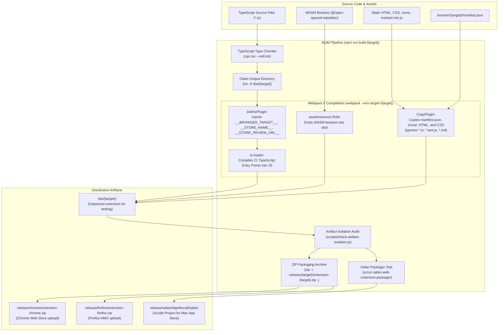

# Build Process & Tooling Architecture

## 1. Overview of the Build Pipeline

The AlgoRecall build pipeline is orchestrated by **Webpack 5** and **TypeScript** (`tsc`), defined in [`webpack.config.js`](file:///Users/anmolrastogi/Documents/GitHub/algomonster-fsrs-extension/webpack.config.js).

The pipeline supports three distinct browser build targets: `chrome`, `firefox`, and `safari`.

---

## 2. Build and Deployment Pipeline Diagram (Diagram 11)



---

## 3. Webpack Configuration Details

### 3.1 21 Separate Entry Points
Rather than emitting a single monolithic bundle, Webpack compiles each UI page and background script independently:
- `config`: `features/tracker/config/fsrsConfig.ts` $\to$ `dist/config.bundle.js`
- `fsrsScheduler`: `features/tracker/scheduler/fsrsScheduler.ts` $\to$ `dist/fsrsScheduler.bundle.js`
- `background/background`: `background/background.ts` $\to$ `background/background.js`
- `content/content`: `content/content.ts` $\to$ `content/content.js`
- Plus 17 individual UI page entries.

### 3.2 Strict `CopyPlugin` Ignore Rules
To prevent raw `.ts` source files or test scripts from leaking into production distributions:
```javascript
const ignorePatterns = ['**/*.test.js', '**/__tests__/**', '**/*.md', '**/*.ts'];

new CopyPlugin({
    patterns: [
        { from: `browser/${targetBrowser}/manifest.json`, to: 'manifest.json' },
        { from: 'icons', to: 'icons', noErrorOnMissing: true },
        { from: 'background', to: 'background', noErrorOnMissing: true, globOptions: { ignore: ignorePatterns } },
        { from: 'content', to: 'content', noErrorOnMissing: true, globOptions: { ignore: ignorePatterns } },
        { from: 'features', to: 'features', noErrorOnMissing: true, globOptions: { ignore: ignorePatterns } }
    ]
})
```

### 3.3 Compile-Time Constant Injection (`DefinePlugin`)
Store-specific URLs and browser target names are resolved at compile time:
```javascript
new webpack.DefinePlugin({
    '__BROWSER_TARGET__': JSON.stringify(targetBrowser),
    '__STORE_NAME__': JSON.stringify(storeConfig.storeName),
    '__STORE_REVIEW_URL__': JSON.stringify(storeConfig.reviewUrl),
})
```
This enables dead-code elimination in tree-shaking for platform-specific branches.
