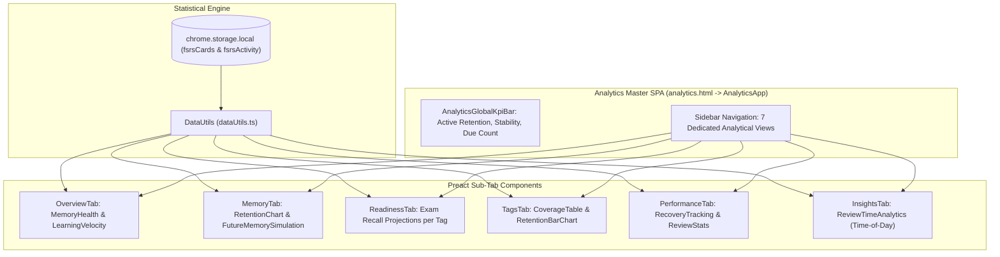

# Analytics Engine Deep Dive

This document details the analytical engine in **AlgoRecall**, explaining the statistical algorithms, memory health metrics, retention calculations, exam readiness model, learning velocity, and future memory simulations implemented in `features/dashboard/analytics/`.

The analytics dashboard is implemented as a modular **Preact 11 single-page application** (`analytics.tsx`) backed by the high-performance `DataUtils` statistical engine (`dataUtils.ts`).

---

## 🔬 Analytics Module Structure & Preact Component Layout

```text
features/dashboard/analytics/
├── analytics.html                     # Minimal HTML entry shell (#root)
├── analytics.css                      # Master stylesheet for sidebar, tabs, and charts
├── analytics.tsx                      # Master SPA Controller & AnalyticsGlobalKpiBar
├── utils/
│   └── dataUtils.ts                   # Core DataUtils mathematical aggregation engine (pure TS)
├── overview/
│   ├── overview.tsx                   # OverviewTab, OverviewNextActionBanner
│   ├── memoryHealth.tsx               # Memory Health score calculation & visual meter
│   ├── learningVelocity.tsx           # 7-day / 14-day velocity sparkline components
│   └── miniForecast.tsx               # 7-day mini review workload strip
├── memory/
│   ├── memory.tsx                     # MemoryTab, PersonalMemoryModelBanner
│   ├── retentionChart.tsx             # True retention vs target retention curve
│   ├── futureMemorySimulation.tsx     # Memory decay simulation slider (0–180 days)
│   ├── confidenceBand.tsx             # Upper/lower retrievability confidence bands
│   └── predictionComparison.tsx       # Model prediction accuracy vs empirical recall
├── readiness/
│   └── readiness.tsx                  # ReadinessTab, ReadinessTopicCard (Exam Forecast)
├── tags/
│   ├── tags.tsx                       # TagsTab, TagsNextActionBanner
│   ├── coverageTable.tsx              # Topic tag retention & lapse breakdown table
│   └── retentionBarChart.tsx          # Comparative topic retention bar chart
├── performance/
│   ├── performance.tsx                # PerformanceTab, PerformanceNextActionBanner
│   ├── recoveryTracking.tsx           # Rehabilitated lapse card tracker
│   └── reviewStats.tsx                # Total reps & rating distribution bars
└── insights/
    ├── insights.tsx                   # InsightsTab, InsightsNextActionBanner
    └── reviewTimeAnalytics.tsx        # Time-of-day behavioral efficiency matrix
```



---

## 🧮 Core Analytics Algorithms (`dataUtils.ts`)

### 1. Retention vs. True Retention
* **Observed Retention**:
  $$\text{Retention} = \frac{\text{Total Reps} - \text{Total Lapses}}{\text{Total Reps}} \times 100$$
* **True Retention (Retrievability Weighting)**: Calculates active retrievability $R(t)$ for each card at current timestamp $t$ based on the FSRS forgetting curve:
  $$\text{True Retention} = \frac{1}{N_{\text{reviewed}}} \sum_{i=1}^{N_{\text{reviewed}}} R_i(t) \times 100$$
  where $R(t) = \left(1 + \text{factor} \cdot \frac{t}{S}\right)^{-\text{decay}}$.

```mermaid
flowchart TD
    subgraph Observed_Retention ["Observed Retention"]
        A1["Sum Total Reps across all cards"] --> B1["Count Total Lapses (Rating: Again)"]
        B1 --> C1["Calculate (Reps - Lapses) / Reps"]
        C1 --> D1["Observed % (Static historical ratio)"]
    end

    subgraph True_Retention ["True Retention (Active Decay)"]
        A2["For each reviewed card i at timestamp now"] --> B2["Calculate elapsed days: t = (now - last_review)"]
        B2 --> C2["Compute Retrievability: R_i(t) = (1 + factor * t / S)^(-decay)"]
        C2 --> D2["Compute Arithmetic Mean across N cards"]
        D2 --> E2["True Retention % (Models active memory retrievability)"]
    end
```



---

### 2. Memory Health Score
The **Memory Health Score** (0–100) measures overall study deck stability and punctuality:
$$\text{Health} = 0.5 \times \text{True Retention} + 0.3 \times \min(100, \text{Avg Stability} \times 5) + 0.2 \times \max(0, 100 - \text{Overdue Ratio} \times 100)$$

* **$\ge 80$**: 🟢 Excellent — Cards are well-consolidated with minimal overdue reviews.
* **$60 - 79$**: 🟡 Fair — Some cards have decaying retrievability; action recommended.
* **$< 60$**: 🔴 At Risk — Overdue review debt is causing significant retrievability decay.

---

### 3. Exam Readiness Forecast Model
Predicts expected retention for an upcoming interview target date $T_{\text{target}}$:
$$t_{\text{delta}} = \frac{T_{\text{target}} - \text{now}}{86400000} \text{ days}$$
$$R_{\text{projected}}(i) = \left(1 + \text{factor} \cdot \frac{t_{\text{elapsed}} + t_{\text{delta}}}{S_i}\right)^{-\text{decay}}$$

Topics with projected recall $< 75\%$ are automatically flagged as **High Risk** in `ReadinessTopicCard`.

---

## 🔗 Related Documentation
* 📘 [Architecture Overview](file:///Users/anmolrastogi/Documents/GitHub/algomonster-fsrs-extension/docs/architecture/overview.md)
* 📊 [Dashboard & Views Documentation](file:///Users/anmolrastogi/Documents/GitHub/algomonster-fsrs-extension/docs/features/dashboard.md)
* 🧮 [FSRS Mathematical Foundations](file:///Users/anmolrastogi/Documents/GitHub/algomonster-fsrs-extension/docs/scheduler-wasm/fsrs-algorithm.md)
