# Bi-Directional Anki Deck Integration

## 1. Purpose & Interoperability

Many competitive programming students use [Anki](https://apps.ankiweb.net/) for general desktop flashcard study. AlgoRecall provides **seamless, bi-directional Anki interchange** implemented across [`ActionService.ts`](file:///Users/anmolrastogi/Documents/GitHub/algomonster-fsrs-extension/features/common/services/actionService.ts) and [`settings.ts`](file:///Users/anmolrastogi/Documents/GitHub/algomonster-fsrs-extension/features/common/settings/settings.ts).

### Supported Capabilities
1. **Export to Anki TSV (`.txt`)**: Formats all saved problem cards into standard Anki tab-delimited format with `#separator:tab` and `#html:true` directives for direct desktop import.
2. **Import from Anki TSV/TXT**: Ingests tab-delimited text files exported from Anki, automatically initializing new FSRS spaced repetition metrics and preserving problem tags.

---

## 2. Anki Integration Flow (Diagram 10)

```mermaid
graph TD
    subgraph ExportWorkflow["Export to Anki Workflow"]
        EXP_CLICK["User Clicks 'Export Anki Deck'<br/>(Settings or Command Alt+Shift+E)"]
        READ_CARDS["Read fsrsCards from chrome.storage.local"]
        FORMAT_TSV["ActionService.formatCardsForAnki(cards)"]
        
        subgraph TSVStructure["Anki TSV Formatting"]
            DIRECTIVES["Prepend Directives:<br/>#separator:tab<br/>#html:true<br/>#tags column:3"]
            ROW_MAP["For Each Card:<br/>Col 1: Front (Title & URL HTML link)<br/>Col 2: Back (Approach, Complexity, Notes HTML)<br/>Col 3: Tags (Comma-separated)"]
        end
        
        BLOB_CREATE["Create text/plain Blob<br/>Filename: algorecall_anki_YYYY-MM-DD.txt"]
        TRIGGER_DL["ActionService.downloadBlobOrFallback()<br/>chrome.downloads.download()"]
    end

    subgraph ImportWorkflow["Import from Anki Workflow"]
        IMP_INPUT["User Selects Anki Deck File<br/>(.txt or .tsv)"]
        READ_FILE["FileReader.readAsText()"]
        PARSE_LINES["Split lines & Filter empty / comment lines (#)"]
        
        subgraph RowIngestion["Row Parser & Normalization"]
            SPLIT_COLS["Split row by tab (\t)"]
            EXTRACT_FRONT["Parse Problem Title & URL from Col 1"]
            EXTRACT_BACK["Extract Solution Notes from Col 2"]
            EXTRACT_TAGS["Extract Tags from Col 3 (default: ['Anki'])"]
            INIT_FSRS["FsrsScheduler.createCard()<br/>Initializes clean FSRS state (New)"]
        end
        
        MERGE_STORE["Merge with existing fsrsCards in storage<br/>Skip duplicates by canonical URL"]
        CONFIRM_TOAST["Display Toast: 'Imported X cards from Anki'"]
    end

    %% Export Connections
    EXP_CLICK --> READ_CARDS
    READ_CARDS --> FORMAT_TSV
    FORMAT_TSV --> DIRECTIVES
    DIRECTIVES --> ROW_MAP
    ROW_MAP --> BLOB_CREATE
    BLOB_CREATE --> TRIGGER_DL

    %% Import Connections
    IMP_INPUT --> READ_FILE
    READ_FILE --> PARSE_LINES
    PARSE_LINES --> SPLIT_COLS
    SPLIT_COLS --> EXTRACT_FRONT
    SPLIT_COLS --> EXTRACT_BACK
    SPLIT_COLS --> EXTRACT_TAGS
    EXTRACT_FRONT --> INIT_FSRS
    EXTRACT_BACK --> INIT_FSRS
    EXTRACT_TAGS --> INIT_FSRS
    INIT_FSRS --> MERGE_STORE
    MERGE_STORE --> CONFIRM_TOAST
```



---

## 3. Anki Export Format Specification

The exported file generated by `ActionService.formatCardsForAnki()` follows this exact format:

```tsv
#separator:tab
#html:true
#tags column:3
<a href="https://leetcode.com/problems/two-sum/">Two Sum</a>	<div><strong>Approach:</strong><br>Hash map storing complement lookups.<br><strong>Complexity:</strong> Time: O(n) | Space: O(n)</div>	Array,Hash_Table,AlgoRecall
<a href="https://leetcode.com/problems/lru-cache/">LRU Cache</a>	<div><strong>Approach:</strong><br>Hash map + Doubly Linked List.<br><strong>Complexity:</strong> Time: O(1) | Space: O(capacity)</div>	Design,Linked_List,AlgoRecall
```

When imported into Anki Desktop, Anki creates clean 2-sided flashcards with working hyperlinks, formatted HTML solution notes, and populates the deck tag index.
