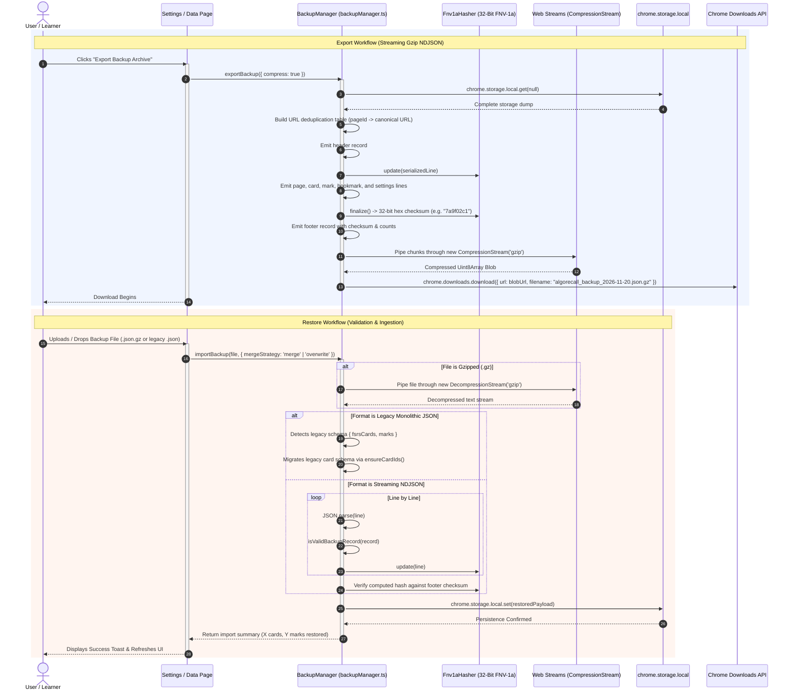

# Streaming Gzip Backup, Checksums & Data Restoration

## 1. Overview & Format Specifications

AlgoRecall provides an optimized data export and restoration engine in [`features/common/data/backupManager.ts`](file:///Users/anmolrastogi/Documents/GitHub/algomonster-fsrs-extension/features/common/data/backupManager.ts).

### Format Evolution: From Legacy JSON to Gzip NDJSON
Early extension versions exported a monolithic uncompressed JSON object containing full duplicated URLs across every card and highlight. For large card inventories, this created multi-megabyte files that crashed browser tabs during serialization.

The modern format uses **Newline Delimited JSON (NDJSON)** compressed with **Gzip** via the Web Streams API:
- **File Extension**: `.json.gz` (or `.jsonl` when uncompressed).
- **URL Deduplication**: Problem URLs are stored once in `page` records; `card`, `mark`, and `bookmark` records reference pages by numerical `pageId`.
- **Integrity Verification**: Employs an incremental 32-bit FNV-1a checksum in the footer record.

---

## 2. Backup Record Types (`types/backup.ts`)

An exported archive consists of sequential JSON lines adhering to the `BackupRecord` discriminated union:

1. **`header`**:
   ```json
   {"type":"header","data":{"version":2,"app":"AlgoRecall","exportedAt":1700000000000,"format":"ndjson-gzip","counts":{"pages":50,"cards":120,"marks":35}}}
   ```
2. **`page`** (URL Deduplication Record):
   ```json
   {"type":"page","data":{"pageId":1,"url":"https://leetcode.com/problems/two-sum/","title":"Two Sum"}}
   ```
3. **`card`** (Spaced Repetition Problem Card):
   ```json
   {"type":"card","data":{"id":"two-sum-1","pageId":1,"due":1700500000000,"stability":4.2,"difficulty":5.1,"approach":"Hash map complements","historyLog":[...]}}
   ```
4. **`mark`** (Highlight Annotation):
   ```json
   {"type":"mark","data":{"id":"mark-uuid-1","pageId":1,"text":"Hash table lookup is O(1)","color":"#f1c40f","createdAt":1700000000000}}
   ```
5. **`settings`**:
   ```json
   {"type":"settings","data":{"theme":"dark","notificationSettings":{...},"extensionSettings":{...}}}
   ```
6. **`footer`** (Integrity Checksum):
   ```json
   {"type":"footer","data":{"recordCount":207,"checksum":"a3f81c9b"}}
   ```

---

## 3. Backup and Restore Sequence Diagram (Diagram 9)


