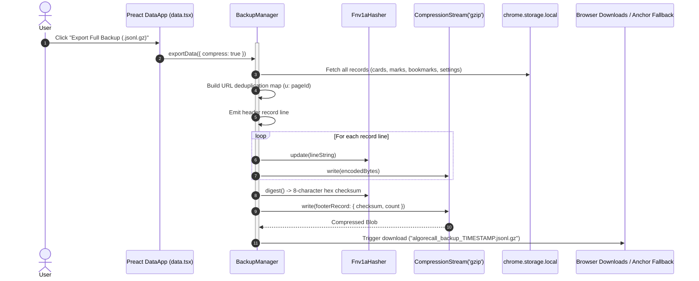

# Common Utilities & Shared Infrastructure

This document describes shared utilities, domain constants, and reusable UI components in `features/common/`. It covers the **Preact shared component library**, `BackupManager` (Gzip JSONL streaming parser), FNV-1a checksum engine, domain whitelisting, Firebase integration, theme synchronization, and logging.

---

## ⚛️ Shared Preact Component & Hook Library

AlgoRecall maintains shared UI primitives in `features/common/ui/`:

### 1. Accessible Toggle Component ([`features/common/ui/components/Toggle.tsx`](file:///Users/anmolrastogi/Documents/GitHub/algomonster-fsrs-extension/features/common/ui/components/Toggle.tsx))
Standardized Preact toggle switch replacing repetitive DOM toggle boilerplate.
* **`ToggleProps`**:
  ```typescript
  export interface ToggleProps {
      id?: string;
      checked: boolean;
      onChange: (checked: boolean) => void;
      label?: string;
      description?: string;
      disabled?: boolean;
      className?: string;
  }
  ```
* **Features**: Accessible label association, keyboard interaction, disabled states, and smooth CSS slider transitions.

### 2. Reactive Chrome Storage Hook ([`features/common/ui/hooks/useStorage.ts`](file:///Users/anmolrastogi/Documents/GitHub/algomonster-fsrs-extension/features/common/ui/hooks/useStorage.ts))
Provides two-way binding between Preact components and `chrome.storage.local`. Automatically updates local state when changes occur from background workers or other tabs via `chrome.storage.onChanged`.
* **Signature**:
  ```typescript
  export function useStorage<T>(
      key: string,
      defaultValue: T
  ): [T, (newValue: T | ((prev: T) => T)) => Promise<void>, boolean]
  ```

### 3. Chip-Based Tag Input Control ([`features/common/utils/tagInput.tsx`](file:///Users/anmolrastogi/Documents/GitHub/algomonster-fsrs-extension/features/common/utils/tagInput.tsx))
Transforms inputs into interactive chip tag lists with autocomplete suggestions and keyboard navigation (Enter, Comma, Backspace, Arrow keys).

---

## 📦 Streaming Backup & Restore Manager (`backupManager.ts`)

The `BackupManager` provides zero-memory-leak, high-performance data exports and restorations for AlgoRecall.

### Key Capabilities
* **Gzip Compression**: Uses native Web Streams `CompressionStream('gzip')` and `DecompressionStream('gzip')`.
* **Streaming JSON Lines (JSONL)**: Reads and writes data line-by-line using async generators (`readLines`), avoiding large in-memory string concatenations.
* **URL Deduplication**: Replaces repeated problem URLs across cards, marks, bookmarks, and page contents with integer keys (`u: pageId`), reducing file size by up to 70%.
* **FNV-1a Checksum Integrity**: Computes an 8-character hex 32-bit FNV-1a hash across stream lines to verify backup file integrity before DB hydration.
* **Legacy Format Migration**: Auto-detects legacy JSON backup files (`importLegacy`) and seamlessly converts schemas.

```typescript
export class Fnv1aHasher {
    private hash: number = 0x811c9dc5;

    update(str: string): void {
        for (let i = 0; i < str.length; i++) {
            this.hash ^= str.charCodeAt(i);
            this.hash = (this.hash * 0x01000193) >>> 0;
        }
    }

    digest(): string {
        return this.hash.toString(16).padStart(8, '0');
    }
}
```



---

## 🛡️ Markdown Rendering & DOMPurify Sanitization (`markdown.ts`)

Converts Markdown notes into safe HTML using **marked.js** coupled with **DOMPurify**:
1. **GitHub Flavored Markdown**: Enabled with line breaks (`breaks: true`, `gfm: true`).
2. **Strict Sanitization**: Strips `<script>`, `<iframe>`, `<object>`, `<embed>`, `<form>`, and inline `onload/onerror` handlers to neutralize XSS vectors.

---

## 🎨 Cross-Page Theme Synchronization (`theme-sync.ts`)

Prevents Flash of Unstyled Content (FOUC) across extension HTML pages:
* Loaded synchronously in `<head>` before body parsing:
  ```html
  <script src="../../common/theme-sync.js"></script>
  ```
* Reads cached theme from `chrome.storage.local` and toggles `.light-theme` on `document.documentElement`.
* Listens to `chrome.storage.onChanged` to synchronize theme changes across open tabs in real time.

---

## 📡 Action Service & Command Router (`actionService.ts`)

Decouples UI button clicks and `chrome.commands` keyboard shortcuts from specific extension view lifecycles:
* Supports 24 standardized actions (`open-analytics`, `check-due-reviews`, `export-backup`, etc.).
* Operates reliably in background workers or popup views without requiring DOM availability.

---

## 🔗 Related Documentation
* 📘 [Architecture Overview](file:///Users/anmolrastogi/Documents/GitHub/algomonster-fsrs-extension/docs/architecture/overview.md)
* 📦 [State Management Architecture](file:///Users/anmolrastogi/Documents/GitHub/algomonster-fsrs-extension/docs/architecture/state-management.md)
* 🔄 [End-to-End Data Pipelines](file:///Users/anmolrastogi/Documents/GitHub/algomonster-fsrs-extension/docs/architecture/data-flow.md)
