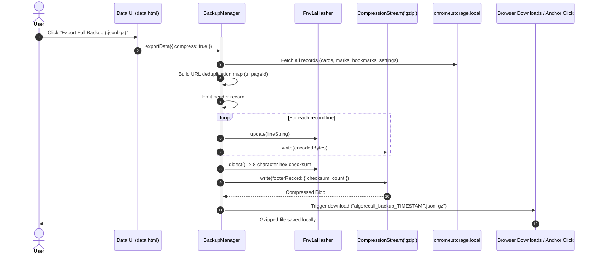
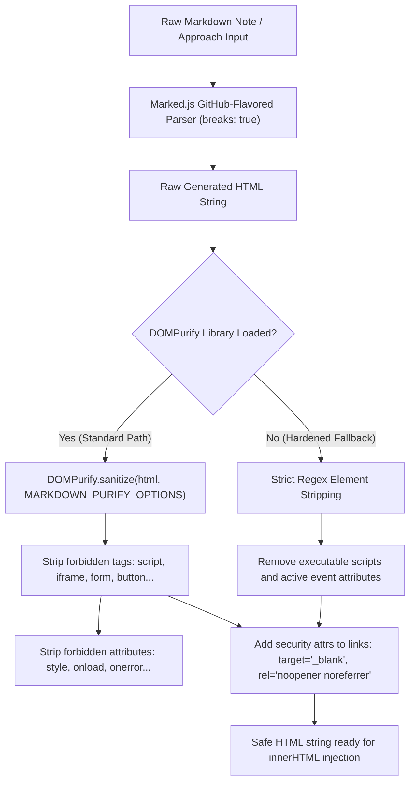
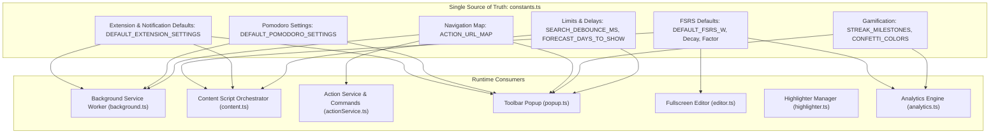
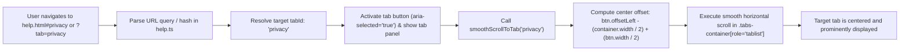

# Common Utilities & Shared Infrastructure

This document describes shared utilities and infrastructure services in `features/common/`, including `BackupManager` (Gzip JSONL streaming parser), FNV-1a checksum engine, domain whitelisting, Firebase integration, theme synchronization, and logging.

---

## 📦 Backup & Restore Manager (`backupManager.ts`)

The `BackupManager` provides zero-memory-leak, high-performance data exports and restorations for AlgoRecall.

### Key Capabilities
* **Gzip Compression**: Uses native Web Stream `CompressionStream('gzip')` and `DecompressionStream('gzip')`.
* **Streaming JSON Lines (JSONL)**: Reads and writes data line-by-line using async generators (`readLines`), avoiding large in-memory string concatenations.
* **URL Deduplication**: Replaces repeated problem URLs across cards, marks, bookmarks, and page contents with integer keys (`u: pageId`), reducing file size by up to 70%.
* **FNV-1a Checksum Integrity**: Computes an 8-character hex 32-bit FNV-1a hash across stream lines to verify backup file integrity before DB hydration.
* **Legacy Format Migration**: Auto-detects legacy JSON backup files (`importLegacy`) and seamlessly converts schemas.

```typescript
export class Fnv1aHasher {
    private hash: number = 0x811c9dc5;

    update(str: string): void {
        for (let i = 0; i < str.length; i++) {
            this.hash ^= str.charCodeAt(i);
            this.hash = (this.hash * 0x01000193) >>> 0;
        }
    }

    digest(): string {
        return this.hash.toString(16).padStart(8, '0');
    }
}
```



---

## 🌐 Website Whitelisting & Domain Routing (`websites.ts`)

AlgoRecall enforces domain whitelisting to restrict content script overlays and highlighters exclusively to approved coding platforms.

### Default Whitelisted Domains
1. `algo.monster`
2. `systemdesignschool.io`
3. `leetcode.com`
4. `codeforces.com`
5. `codechef.com`
6. `atcoder.jp`
7. `hackerrank.com`
8. `hackerearth.com`
9. `codewars.com`
10. `codingame.com`

Users can add custom domains via `features/common/websites/websites.html`.

---

## 🛡️ Markdown Parsing & DOMPurify Sanitization (`markdown.ts`)

The markdown rendering utility (`features/common/markdown.ts`) formats problem solution approaches, complexity analysis, and annotations while preventing cross-site scripting (XSS) and DOM injection attacks.

### Security & Sanitization Architecture
1. **Marked.js Integration**: Upgraded to modern marked parser with GitHub-flavored markdown (`gfm: true`) and automated line breaks (`breaks: true`).
2. **DOMPurify Sanitization**: All HTML generated from markdown parsing is processed through DOMPurify using centralized options (`MARKDOWN_PURIFY_OPTIONS`):
   ```typescript
   export const MARKDOWN_PURIFY_OPTIONS = {
       FORBID_TAGS: ['form', 'input', 'button', 'select', 'textarea', 'script', 'iframe', 'object', 'embed', 'style', 'link', 'meta'],
       FORBID_ATTR: ['style']
   };
   ```
3. **Defense-in-Depth Fallback**: If DOMPurify is unavailable in a minimalist execution environment, a strict regex replacement strips all dangerous active and executable elements before DOM insertion.



---

## 📐 Centralized Domain Constants (`constants.ts`)

AlgoRecall enforces a strict single-source-of-truth pattern through [`features/common/constants.ts`](file:///Users/anmolrastogi/Documents/GitHub/algomonster-fsrs-extension/features/common/constants.ts), eliminating scattered magic numbers and unaligned fallback defaults across the extension:

* **FSRS & Algorithmic Defaults**: Standard $w$ parameters (`DEFAULT_FSRS_W`), retrievability decay (`DEFAULT_FSRS_DECAY = -0.5`), factor (`DEFAULT_FSRS_FACTOR = 19/81`), and target retention (`DEFAULT_FSRS_REQUEST_RETENTION = 0.90`).
* **Settings & Theme Fallbacks**: `DEFAULT_THEME = 'dark'`, `DEFAULT_HIGHLIGHT_COLOR = '#f1c40f'`, `DEFAULT_EXTENSION_SETTINGS` (including `showMarkerPopup`, `showLauncher`, and active palette), and `DEFAULT_NOTIFICATION_SETTINGS`.
* **Pomodoro Configurations**: Standard 25/5/15 minute interval durations (`DEFAULT_POMODORO_SETTINGS`) and initial statistics schema (`DEFAULT_POMODORO_STATS`).
* **Navigation Routes**: `ACTION_URL_MAP` mapping command identifiers to page paths.
* **Calendars & Time Buckets**: `DAY_NAMES_SHORT`, `MONTH_NAMES`, and `TIME_OF_DAY_BUCKET_NAMES` for review analytics.
* **Gamification Milestones**: `DEFAULT_DAILY_GOAL = 10`, `STREAK_MILESTONES`, `REVIEW_MILESTONES`, and `CONFETTI_COLORS`.
* **Search & Workload Limits**: `SEARCH_DEBOUNCE_MS = 150`, `SEARCH_MAX_RESULTS = 5`, and `FORECAST_DAYS_TO_SHOW = 30`.



---

## 🎨 Theme Synchronization, Brand Identity & Logger (`theme-sync.ts`, `logger.ts`)

* **Theme Sync (`theme-sync.ts`)**: Watches `chrome.storage.local` theme changes and updates `:root` CSS class (`light-theme` vs dark mode) across all active tabs and extension popups.
* **Brand Identity Component (`algo-brand-pill`)**: Reusable header pill styled in `features/common/base.css` displaying the AlgoRecall icon, name, and live manifest version across every standalone HTML view.
* **Structured Logger (`logger.ts`)**: Centralized logger providing environment-aware console logging (`Logger.info`, `Logger.debug`, `Logger.error`, `Logger.time`, `Logger.timeEnd`) with context tagging, in-memory ring buffer (`LOGGER_MAX_BUFFER_SIZE = 1000`), and JSON export.

---

## 📖 Help Center & Privacy Hub (`help.html`, `help.ts`)

The Help Center is an interactive Single-Page Application (SPA) providing comprehensive documentation, strategy guides, FSRS tutorials, and complete data privacy transparency.

### Navigation Tabs
1. **🚀 Getting Started & Strategy (`overview`)**: Core study strategies, step-by-step workflow, and platform onboarding.
2. **🧠 FSRS & Review Engine (`fsrs`)**: FSRS mathematical formula, stability/difficulty mechanics, rating matrix (Again/Hard/Good/Easy), and review intervals.
3. **🖍️ Highlighter & Notes (`highlighter`)**: Inline text annotations, underlines, custom color palettes, and note-taking.
4. **📊 Analytics & Science (`analytics`)**: Retention rates, review forecasts, tag distributions, and memory health graphs.
5. **🎮 Gamification & Focus (`gamification`)**: Daily streaks, XP, level progression, badges, and Pomodoro timer.
6. **⚙️ Advanced, Anki & Licensing (`advanced`)**: Anki APKG/TSV deck import/export, JSON state restoration, and open-source licenses.
7. **🛡️ Privacy & Data Policy (`privacy`)**:
   * **Local-First Architecture**: 100% of study data, cards, and notes stored in `chrome.storage.local` by default without tracking.
   * **Zero Monetization of Data**: Strict certification that no personal data is sold, rented, or used for third-party advertising.
   * **Minimal Permissions Breakdown**: Detailed justification of every manifest permission (`storage`, `activeTab`, `alarms`, `notifications`, `downloads`, `webNavigation`, `scripting`).
   * **Cloud Sync Clarification**: Optional Pro tier integration with Firebase Auth (Google OAuth) and encrypted Firestore storage.
   * **Data Ownership & Portability**: Instructions on JSON export, Anki migration, and GDPR one-click data wipe.
   * **Direct URL Routing**: Accessible directly from the popup footer via `help.html?tab=privacy`.

### Deep Linking, Hash Routing & Smooth Tablist Scrolling
* **Flexible Deep Linking**: Supports direct tab activation from external pages via URL query parameters (`help.html?tab=privacy`) or URL hash fragments (`help.html#privacy` or `help.html#tab-privacy`).
* **Dynamic Hash Navigation**: Listens to browser `hashchange` events (`bindHashNavigation()`) to enable forward/backward navigation and intra-page anchor jumps without page refreshes.
* **Centered Smooth Scrolling inside `role="tablist"`**:
  * The tab navigation container (`.tabs-container[role="tablist"]`) enforces `scroll-behavior: smooth` and `-webkit-overflow-scrolling: touch`.
  * `smoothScrollToTab(tabId)` dynamically calculates the tab button's horizontal offset relative to the scroll container (`tabBtn.offsetLeft - (container.clientWidth / 2) + (tabBtn.clientWidth / 2)`) and executes smooth centering.
  * Ensures that when navigating directly to off-screen tabs (such as the Privacy tab on narrow screens or laptops), the tablist automatically scrolls smoothly to bring the active button into prominent view.



---

## 🔗 Related Documentation
* 🔄 [End-to-End Data Flow](file:///Users/anmolrastogi/Documents/GitHub/algomonster-fsrs-extension/docs/architecture/data-flow.md)
* 📐 [Global Types & Utilities](file:///Users/anmolrastogi/Documents/GitHub/algomonster-fsrs-extension/docs/runtime-core/utils-and-types.md)
* 🛠️ [Customization Guide](file:///Users/anmolrastogi/Documents/GitHub/algomonster-fsrs-extension/docs/CUSTOMIZATION.md)
