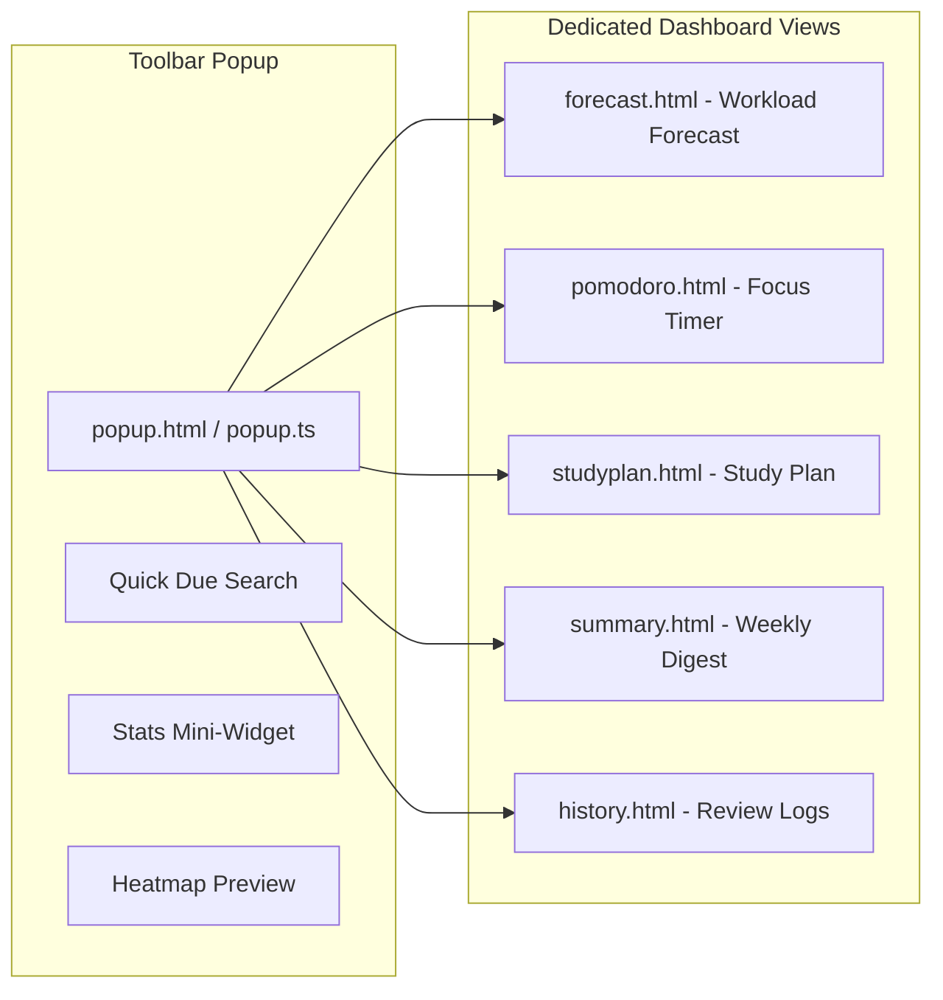

# Dashboard & Extension Views

This document provides a technical overview of the primary extension dashboard pages and popup interfaces in **AlgoRecall**.

---

## 🖼️ Dashboard Architecture

AlgoRecall provides dedicated HTML/TS popup and dashboard views:

```text
features/dashboard/
├── popup/           # Extension toolbar popup (search, stats, due list, quick rating)
├── forecast/        # 30-day review workload forecast chart
├── pomodoro/        # Persistent Pomodoro focus timer linked to background SW
├── studyplan/       # AI & algorithmic study plan generator based on due cards & tags
├── summary/         # Weekly digest generator view
├── history/         # Chronological review log audit view
└── heatmap/         # GitHub-style 365-day review activity heatmap
```



---

## ⏱️ Persistent Pomodoro Timer Sync (`pomodoro.ts`)

The Pomodoro module provides a focus timer synchronized between the frontend UI and the background service worker:
1. **Running Timer**: When started, target completion timestamp (`targetEndTime`) is written to `pomodoroState` in `chrome.storage.local`.
2. **Background Ticker**: `AlgoRecallBackground.startPomodoroTick()` updates the extension badge text (`15m`, `45s`) and icon title every second.
3. **Service Worker Alarm**: A `pomodoroEnd` Chrome alarm is scheduled so that if the background worker goes idle, Chrome wakes it up at exact timer expiration.
4. **Phase Transitions**: Focus (25 min) $\rightarrow$ Short Break (5 min) $\rightarrow$ Long Break (15 min after 4 sessions).

---

## 📊 Forecast & Review Workload (`forecast.ts`)

The Forecast module projects future review workload across a 30-day window:
* Iterates over `fsrsCards` in storage.
* Groups due timestamps (`card.due`) into calendar dates ($YYYY-MM-DD$).
* Calculates projected review counts per day to help users plan study sessions.

---

## 📜 Review History Audit (`history.ts`)

The History view provides an audit trail of all past review interactions:
* Extracts `historyLog` entries across all stored cards.
* Displays rating choice (`Again`, `Hard`, `Good`, `Easy`), review date, duration, and stability progression.
* Filters history by problem title, tag, or rating.

---

## ⌨️ Keyboard Shortcuts & Centralized Action Service (`actionService.ts`)

AlgoRecall implements a decoupled, headless action architecture coordinating popup click events and native browser keyboard shortcuts. All user-facing commands route through `ActionService` ([`features/common/services/actionService.ts`](file:///Users/anmolrastogi/Documents/GitHub/algomonster-fsrs-extension/features/common/services/actionService.ts)), executing reliably whether the popup DOM is open or closed.

### 1. Browser Commands API Support (`chrome.commands`)
The extension registers 24 commands conforming to Chromium's hard limit of at most 4 pre-bound `suggested_key` shortcuts:

* **Pre-Bound Default Shortcuts**:
  * `_execute_action`: `Ctrl+Shift+A` (macOS: `Cmd+Shift+A`) — Opens AlgoRecall Extension Popup.
  * `check-due-reviews`: `Alt+Shift+R` (macOS: `Alt+Shift+R`) — Manually triggers due reviews check and updates action icon badge.
  * `view-due-cards`: `Alt+Shift+D` (macOS: `Alt+Shift+D`) — Opens Data Dashboard filtered to due review queue (`data.html?view=due`).
  * `open-study-plan`: `Alt+Shift+S` (macOS: `Alt+Shift+S`) — Opens Study Plan Generator (`studyplan.html`).

* **Configurable Commands (Native Browser Shortcut Managers)**:
  20 additional commands are declared with descriptions in manifests across Chrome, Firefox, and Safari for customized key binding in `chrome://extensions/shortcuts` or `about:addons`:
  * Toggles: `toggle-theme`, `toggle-floating-marker`, `toggle-algo-launcher`, `toggle-notifications`.
  * Navigation: `open-analytics`, `open-pomodoro`, `open-forecast`, `open-history`, `open-heatmap`, `open-summary`, `open-highlights`, `open-highlight-options`, `open-data`, `open-fsrs-settings`, `open-websites`, `open-help`, `open-welcome`, `view-all-cards`, `view-retention-cards`.
  * Data & Reviews: `export-anki`, `export-backup`, `open-rate-extension`.

* **Authoritative Patch Audit**:
  The complete 53-item user functionality audit, classification, and shortcut mapping is maintained in [`docs/keyboard-shortcuts-audit.patch`](file:///Users/anmolrastogi/Documents/GitHub/algomonster-fsrs-extension/docs/keyboard-shortcuts-audit.patch).

* **Cross-Browser Store Review Routing (`rateExtension()`)**:
  Build-time injection via `BROWSER_CONFIG.reviewUrl` automatically directs users to their platform's specific store:
  * **Chrome**: Dynamic slug formatting using `chrome.runtime.id` to open Chrome Web Store reviews.
  * **Firefox**: Static slug opening Firefox Add-ons (`addons.mozilla.org`) reviews.
  * **Safari**: Direct Mac App Store (`apps.apple.com`) product review page routing.

---

## 🏷️ Due Cards Badge Counter & Preferences

* **Dynamic Action Badge**: The extension action icon dynamically reflects the real-time count of due review cards (`updateDueCardsBadge()`).
* **User Toggle Control (`badgeEnabled`)**: Users can toggle badge counter visibility on or off in the Popup Notification Settings panel, persisting to `notificationSettings.badgeEnabled` in `chrome.storage.local`.
* **Instant Sync**: Toggling the preference immediately updates or clears the toolbar badge without requiring a browser reload.

---

## 🚀 Problem Tracker Launcher Toggle (`showLauncher`)

* **Visibility Preference**: A dedicated switch in popup settings allows users to hide the in-page floating quick launcher button (`algo-fsrs-launcher`) on whitelisted problem pages.
* **Storage Persistence**: Stored under `extensionSettings.showLauncher` in `chrome.storage.local`.
* **Zero Disruption**: Keyboard shortcuts and context menus remain fully operational even when the visual launcher button is disabled.

---

## 🎨 Reusable Brand Identity Component (`algo-brand-pill`)

All standalone dashboard views (`data.html`, `help.html`, `websites.html`, `analytics.html`, `forecast.html`, `heatmap.html`, `history.html`, `pomodoro.html`, `studyplan.html`, `summary.html`, `highlights.html`, `highlightOptions.html`, `fsrsConfig.html`, `editor.html`) embed a unified brand header:
* Displays the official AlgoRecall icon and title.
* Dynamic version badge synchronized with the extension manifest.
* Consistent styling via [`features/common/base.css`](file:///Users/anmolrastogi/Documents/GitHub/algomonster-fsrs-extension/features/common/base.css).

---

## 🔗 Related Documentation
* 📈 [Analytics Engine](file:///Users/anmolrastogi/Documents/GitHub/algomonster-fsrs-extension/docs/features/analytics.md)
* ⚙️ [Background Service Worker](file:///Users/anmolrastogi/Documents/GitHub/algomonster-fsrs-extension/docs/runtime-core/background-service.md)
* 🎯 [Tracker & Editor](file:///Users/anmolrastogi/Documents/GitHub/algomonster-fsrs-extension/docs/features/tracker.md)
* ⌨️ [Keyboard Shortcuts Audit Patch](file:///Users/anmolrastogi/Documents/GitHub/algomonster-fsrs-extension/docs/keyboard-shortcuts-audit.patch)
