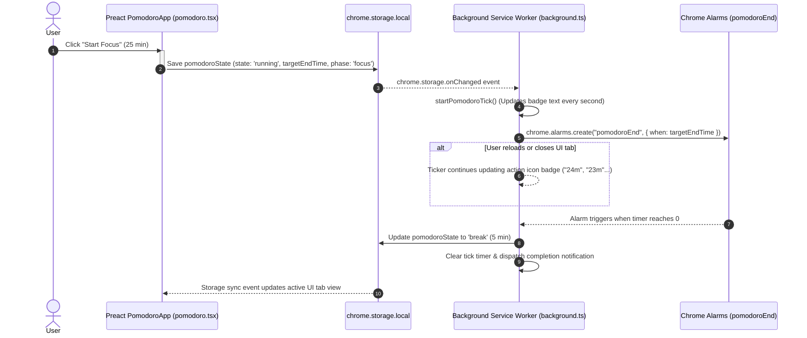

# Dashboard & Extension Views

This document provides a technical overview of the primary extension dashboard pages and popup interfaces in **AlgoRecall**. All views are implemented as component-driven **Preact single-page applications** (`.tsx`) that mount to minimal HTML shells (`#root`).

---

## 🖼️ Dashboard Architecture & Preact Module Layout

The dashboard suite is located in `features/dashboard/`:

```text
features/dashboard/
├── popup/                       # Browser action popup Preact SPA
│   ├── popup.html               # Minimal HTML entry shell (#root)
│   ├── popup.css                # Scoped 350px popup viewport stylesheet
│   ├── popup.tsx                # PopupApp root component & NavigationGrid
│   ├── stats.tsx                # PopupStatsOverview, DailyGoalRing, GamificationCard
│   ├── search.tsx               # QuickSearchComponent & PopupSearchResultItem
│   ├── heatmap.tsx              # PopupHeatmapGrid & PopupHeatmapCell
│   ├── notifications.tsx        # PopupNotificationSettings & PermissionWarningBanner
│   ├── rating.tsx               # PopupRatingPromptCard (Web Store review prompt)
│   └── DashboardComponent.tsx   # DashboardCoordinator contract & base class
├── forecast/                    # 30-day review workload forecast SPA
│   ├── forecast.html            # Minimal HTML entry shell (#root)
│   ├── forecast.css             # Forecast cards & SVG workload bar chart
│   └── forecast.tsx             # ForecastApp, ForecastMetricsHeader, ForecastCalendar
├── pomodoro/                    # Persistent Pomodoro focus timer SPA
│   ├── pomodoro.html            # Minimal HTML entry shell (#root)
│   ├── pomodoro.css             # Focus/Break timer ring & phase theme styling
│   └── pomodoro.tsx             # PomodoroApp, PomodoroTimerRing, PomodoroControls
├── studyplan/                   # Exam Countdown Mode SPA
│   ├── studyplan.html           # Minimal HTML entry shell (#root)
│   ├── studyplan.css             # Countdown ring & schedule breakdown table
│   └── studyplan.tsx            # StudyPlanApp, StudyPlanCountdownRing, SetupPanel
├── summary/                     # Weekly & monthly digest performance report SPA
│   ├── summary.html             # Minimal HTML entry shell (#root)
│   ├── summary.css              # KPI hero cards, insight pills, topic mastery bars
│   ├── summary.tsx              # SummaryApp, SummaryPeriodTabs, SummaryKpiGrid
│   └── summaryGenerator.ts      # Pure calculation engine generating digest metrics
├── history/                     # Chronological review log audit SPA
│   ├── history.html             # Minimal HTML entry shell (#root)
│   ├── history.css              # Review timeline, year/month/day drill-down cards
│   └── history.tsx              # HistoryApp, HistoryViewToggle, HistoryBarChart
└── heatmap/                     # Full-screen 365-day review activity heatmap SPA
    ├── heatmap.html             # Minimal HTML entry shell (#root)
    ├── heatmap.css              # Matrix grid, intensity levels, streak cards
    ├── heatmap.tsx              # HeatmapApp, HeatmapFilterBar, HeatmapGrid
    └── heatmap-stats.tsx        # StreakStatCard & streak calculation engine
```

```mermaid
graph TD
    subgraph Browser_Action_Popup ["Popup SPA (popup.html -> PopupApp)"]
        PH[PopupHeader: Brand & Theme Toggle]
        PS[PopupStatsOverview: Total, Due, Retention]
        PGR[PopupDailyGoalRing: SVG Progress Ring]
        PGC[PopupGamificationCard: XP Bar & Level]
        PQS[PopupSearchResultsList: Fast Filter Search]
        PHM[PopupHeatmapGrid: Mini Contribution Strip]
        PN[PopupNotificationSettings: Quiet Hours & Alarms]
        PR[PopupRatingPromptCard: Store Review Trigger]
        PNAV[PopupNavigationGrid: Launchers to Dedicated Tabs]
    end

    subgraph Dedicated_Preact_Dashboards ["Dedicated Options Tabs (#root)"]
        FC["ForecastApp (forecast.html)"]
        PM["PomodoroApp (pomodoro.html)"]
        SP["StudyPlanApp (studyplan.html)"]
        SM["SummaryApp (summary.html)"]
        HS["HistoryApp (history.html)"]
        HM["HeatmapApp (heatmap.html)"]
        DATA["DataApp (data.html)"]
        CONF["FSRSConfigApp (fsrsConfig.html)"]
    end

    PNAV --> FC
    PNAV --> PM
    PNAV --> SP
    PNAV --> SM
    PNAV --> HS
    PNAV --> HM
    PNAV --> DATA
    PNAV --> CONF
```



---

## ⏱️ Persistent Pomodoro Timer Sync (`pomodoro.tsx`)

The Pomodoro module provides a focus timer synchronized between the Preact frontend UI (`PomodoroApp`) and the background service worker:
1. **Running Timer**: When started, target completion timestamp (`targetEndTime`) is written to `pomodoroState` in `chrome.storage.local`.
2. **Background Ticker**: `AlgoRecallBackground.startPomodoroTick()` updates the extension badge text (`15m`, `45s`) and icon title every second.
3. **Service Worker Alarm**: A `pomodoroEnd` Chrome alarm is scheduled so that if the background worker goes idle, Chrome wakes it up at exact timer expiration.
4. **Phase Transitions**: Focus (25 min) $\rightarrow$ Short Break (5 min) $\rightarrow$ Long Break (15 min after 4 sessions).



---

## 📊 Forecast & Review Workload (`forecast.tsx`)

The Forecast module projects future review workload across a 30-day window:
* **`ForecastMetricsHeader`**: Summarizes upcoming card volume, daily average workload, and today's due load.
* **`ForecastCalendar`**: Generates a 30-day calendar matrix displaying daily due counts.
* **`ForecastChart`**: Renders an interactive bar chart of workload intensity using CSS variable scaling.

---

## 🎯 Exam Countdown Mode (`studyplan.tsx`)

Exam Mode redistributes card intervals evenly between the current date and an upcoming exam target date:
* **`StudyPlanSetupPanel`**: Form allowing users to choose an exam date and daily review cap.
* **`StudyPlanCountdownRing`**: Circular SVG dial displaying the days remaining until the target date.
* **`StudyPlanScheduleTable`**: Detailed breakdown table listing distributed daily problem counts.
* **Non-Destructive Scheduling**: Saves original computed intervals to `preExamDue` so standard FSRS schedules can be restored when exam mode concludes.

---

## 📈 Performance Summary Generator (`summary.tsx` & `summaryGenerator.ts`)

The Summary module provides automated retrospective digests for weekly or monthly study intervals:
* **`SummaryKpiGrid`**: Retention percentage, reviews completed, net card growth, and streak days.
* **`SummaryInsightsList`**: Smart recommendations generated on-the-fly (e.g., identifying lapse clusters).
* **`SummaryTopicMasteryList`**: Progress bars categorizing topic tags by mastery level and retention rate.

---

## 🔗 Related Documentation
* 📘 [Architecture Overview](file:///Users/anmolrastogi/Documents/GitHub/algomonster-fsrs-extension/docs/architecture/overview.md)
* 📈 [Analytics Engine Deep Dive](file:///Users/anmolrastogi/Documents/GitHub/algomonster-fsrs-extension/docs/features/analytics.md)
* 📦 [State Management Architecture](file:///Users/anmolrastogi/Documents/GitHub/algomonster-fsrs-extension/docs/architecture/state-management.md)
