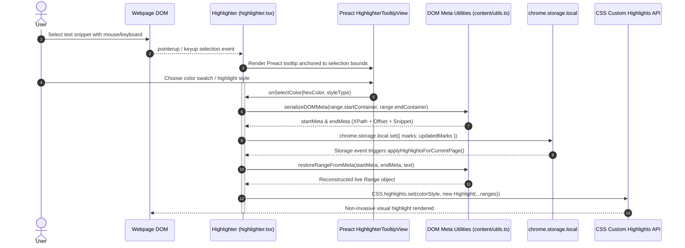

# Highlighter & Annotation Manager

This document provides a technical explanation of the in-page text selection highlighter, floating tooltip UI, CSS Custom Highlights API integration, DOM metadata range restoration, selection preservation mechanics, and Preact options configurations in **AlgoRecall**.

---

## 🖍️ Architecture & CSS Custom Highlights API

AlgoRecall uses the modern **CSS Custom Highlights API** (`CSS.highlights` and `Highlight`) rather than mutating host page DOM nodes with wrapper `<span>` elements. This prevents breaking React/Vue virtual DOM reconciliation on platforms like LeetCode or AlgoMonster.

The highlighter UI components are implemented in **Preact 11 and TypeScript** (`.tsx`):
* **In-Page Floating Tooltip (`highlighter.tsx`)**: Preact component tree (`HighlighterTooltipView`) rendered anchored to user text selections.
* **Highlights Repository Manager (`highlights.tsx`)**: Standalone Preact SPA (`highlights.html` -> `<HighlightsApp />`) for searching, filtering, and exporting snippets.
* **Highlighter Appearance & Palettes (`highlightOptions.tsx`)**: Standalone Preact SPA (`highlightOptions.html` -> `<HighlightOptionsApp />`) for designing custom 5-color palettes.



---

## 🎨 Visual Styles: Highlight vs. Underline

The highlighter supports both traditional background fills and pure underlines:

* **Background Highlight (`type: 'highlight'`)**:
  Applies a semi-transparent background color wash (`${color}40`) behind the text while preserving the host page's text color.
* **Underline (`type: 'underline'`)**:
  Applies a clean text underline (`text-decoration: underline ${color}`) with a completely transparent background (`${color}00`). Unlike legacy implementations that blended background tints with underline styles, the underline style strictly underlines the text with the selected color without background tinting.

Dynamic CSS style rules are registered via `content/utils.ts` and scoped using `::highlight(algo-mark-*)`.

---

## 🛸 Preact Floating Tooltip UI Architecture (`highlighter.tsx`)

When users select text on any whitelisted website, `HighlighterTooltipView` renders an anchored toolbar:

```text
┌─────────────────────────────────────────────────────────────┐
│  (●) (●) (●) (●) (●)   │   [DEF]   │   [🎨]   │   [💬] [🔗] │
│      Palette Swatches  │  Default  │  Picker  │   Actions   │
└─────────────────────────────────────────────────────────────┘
```

### Tooltip Sub-Components
* **`HighlighterTypeSelector`**: Toggles between text highlight and underline modes.
* **`HighlighterSwatches`**: Active 5-color palette swatches with one-click application.
* **`HighlighterColorPicker`**: Native HTML5 color input supporting custom hex codes.
* **`HighlighterNotesSection`**: Category tags and approach note text areas linked to flashcards.
* **`HighlighterDeleteButton`**: Deletes the mark and removes the range from `CSS.highlights`.

---

## 🗃️ Highlights Repository Dashboard (`highlights.tsx`)

The Highlights Manager (`<HighlightsApp />`) provides a dedicated interface for reviewing saved snippets:
* **`ColorFilterBubbles`**: Dynamic color bubbles filtering highlights by color code.
* **`HighlightCardView`**: Individual snippet card displaying source problem title, timestamp, and action buttons.
* **`HighlightsListView`**: Virtualized/responsive stream of filtered highlights with keyword highlighting.
* **Markdown Export**: Exports all filtered snippets as a structured Markdown document.

---

## 🎨 Palette Customization Options (`highlightOptions.tsx`)

The Options page (`<HighlightOptionsApp />`) enables users to build custom themes:
* **`PaletteEditorSlots`**: Dynamic input rows for adding/removing hex color slots within a palette.
* **`PalettesList`**: Visual cards of saved custom and default palettes with one-click activation.

---

## 🔗 Related Documentation
* 📘 [Architecture Overview](file:///Users/anmolrastogi/Documents/GitHub/algomonster-fsrs-extension/docs/architecture/overview.md)
* 🎯 [Tracker & Editor Documentation](file:///Users/anmolrastogi/Documents/GitHub/algomonster-fsrs-extension/docs/features/tracker.md)
* 📦 [State Management Architecture](file:///Users/anmolrastogi/Documents/GitHub/algomonster-fsrs-extension/docs/architecture/state-management.md)
