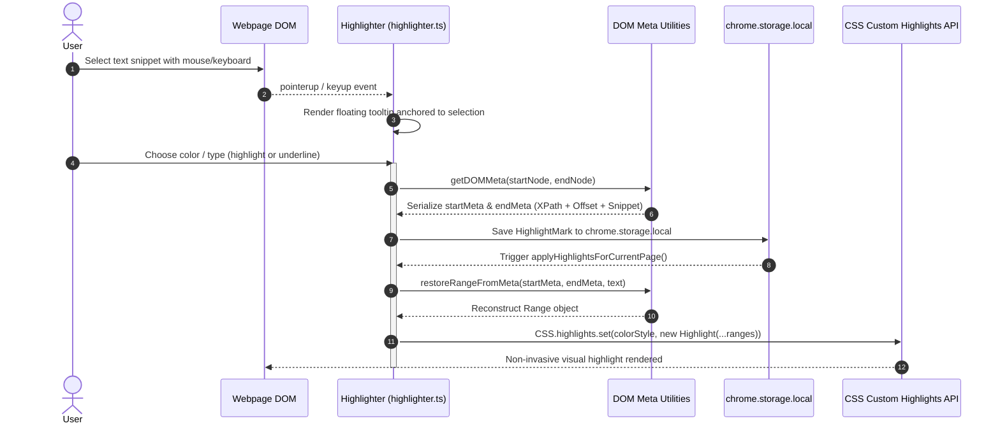
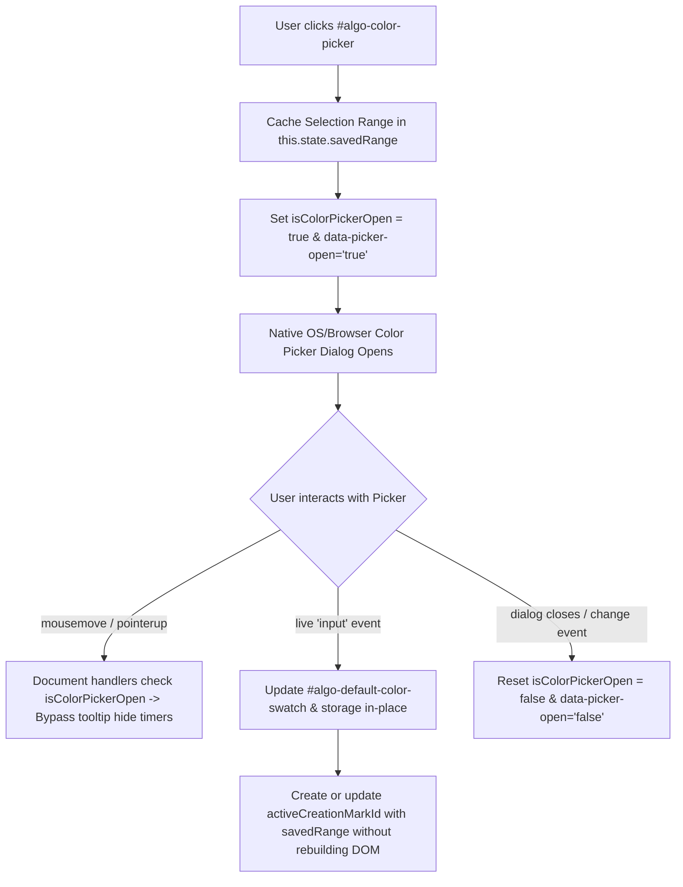

# Highlighter & Annotation Manager

This document provides a technical explanation of the in-page text selection highlighter, floating tooltip UI, CSS Custom Highlights API integration, DOM metadata range restoration, selection preservation mechanics, and options configuration in **AlgoRecall**.

---

## 🖍️ Architecture & Custom CSS Highlights API

AlgoRecall uses the modern **CSS Custom Highlights API** (`CSS.highlights` and `Highlight`) rather than mutating host page DOM nodes with wrapper `<span>` elements. This prevents breaking React/Vue virtual DOM nodes on platforms like LeetCode or AlgoMonster.



---

## 🎨 Visual Styles: Highlight vs. Underline

The highlighter supports both traditional background fills and pure underlines:

* **Background Highlight (`type: 'highlight'`)**:
  Applies a semi-transparent background color wash (`${color}40`) behind the text while preserving the host page's text color.
* **Underline (`type: 'underline'`)**:
  Applies a clean text underline (`text-decoration: underline ${color}`) with a completely transparent background (`${color}00`). Unlike legacy implementations that blended background tints with underline styles, the underline style strictly underlines the text with the selected color without background tinting.

Dynamic CSS style rules are registered via `content/utils.ts` and scoped using `::highlight(algo-mark-*)`.

---

## 🛸 Floating Tooltip UI Architecture (`#algo-highlight-tooltip`)

When users select text on any whitelisted website, `highlighter.ts` dynamically anchors a compact, floating toolbar above or below the selection:

```text
┌─────────────────────────────────────────────────────────────┐
│  (●) (●) (●) (●) (●)   │   [DEF]   │   [🎨]   │   [💬] [🔗] │
│      Palette Swatches  │  Default  │  Picker  │   Actions   │
└─────────────────────────────────────────────────────────────┘
```

### Tooltip Controls
1. **Palette Swatches (`.algo-color-swatch`)**: Quick-select buttons for the active color palette (e.g., Default, Warm Pastels, Ocean Breeze, Sunset Glow).
2. **Dedicated Default Color Swatch (`#algo-default-color-swatch`)**: Positioned at the end of the swatches list with a `DEF` badge (`.default-swatch-badge`), enabling 1-click highlighting with the user's configured default color.
3. **Circular Native Color Picker (`#algo-color-picker`)**: A native `<input type="color">` styled as a circular swatch for choosing arbitrary custom colors.
4. **Streamlined Ergonomics**: The legacy inline hex input (`.algo-color-hex-input`) has been eliminated to maximize tooltip compactness, reduce visual noise, and optimize for fast one-click selection.
5. **Action Controls**: Note attachment dialog (`#algo-note-btn`), card-linking trigger (`#algo-link-card-btn`), and style toggles.

---

## 🛡️ Selection Preservation & Native Color Picker Dialog Lifecycle

Opening native OS/browser color dialogs (`<input type="color">`) creates multiple browser interaction hurdles:
* Focusing the color input causes the host webpage's text selection to collapse (`window.getSelection().isCollapsed === true`).
* Document-level `pointerup` and `mousemove` hover-detection listeners may misinterpret clicks on the color picker as outside clicks, instantly hiding the floating tooltip.
* Naive `input` event listeners that trigger `renderTooltipColors()` wipe out `tooltip.innerHTML`, abruptly destroying the active color picker element and collapsing the native dialog.

### Robust Dialog Lifecycle Mitigation



1. **Range Caching**: On `pointerdown`, `mousedown`, and `click` on `#algo-color-picker`, the current selection range is cached in `this.state.savedRange`.
2. **Open-State Tracking**: `this.state.isColorPickerOpen` and `tooltip.dataset.pickerOpen = 'true'` signal active picker sessions.
3. **Outside-Click & Timer Bypass**: Document-level `pointerup` and `mousemove` listeners verify picker open state before scheduling auto-hide or dismissal timers.
4. **Non-Destructive Live Sync**: During `input` events, the default swatch background is updated in-place and the active mark is modified using `this.state.activeCreationMarkId` to prevent duplicate marks and avoid re-rendering `tooltip.innerHTML`.

---

## 📍 Range Serialization (`DOMMeta`)

To persist text highlights across page reloads without storing volatile DOM node references, `HighlightMark` objects store `DOMMeta` metadata:

```typescript
export interface DOMMeta {
    path?: string;        // Element XPath / DOM hierarchy path
    offset?: number;      // Text node character offset
    textSnippet?: string; // Text content preview for fuzzy validation
}

export interface HighlightMark {
    id: string;
    url: string;
    text: string;
    color: string;
    type?: string;        // 'highlight' or 'underline'
    createdAt: number;
    note?: string;
    category?: string;    // 'Key Insight', 'Gotcha', 'Edge Case', 'Pattern'
    highlightSource?: {
        startMeta?: DOMMeta;
        endMeta?: DOMMeta;
    };
}
```

---

## 🔗 Linking Highlights to FSRS Cards

Highlighters can be directly linked to active FSRS cards (`linkHighlightToCard`):
* Extracts selected text, category prefix, and optional notes.
* Formats note as a markdown blockquote (`> **Key Insight:** ...`).
* Appends content directly to card's `approach` markdown field or active problem draft (`approachDrafts`).

---

## ⚙️ Options & Palette Configurations (`highlightOptions.ts`)

Users can manage highlighter configurations via `highlightOptions.html`:
* **Color Palettes**: Default, Warm Pastels, Ocean Breeze, Forest Moss, Sunset Glow, plus custom user-created palettes.
* **Palette Name Validation**: The `#save-palette-btn` button remains strictly disabled until `#palette-name-input` is non-empty (`trim().length > 0`), preventing invalid or unnamed palette saves.
* **Default Highlight Color**: Set a persistent default highlight color that synchronizes with the `#algo-default-color-swatch` in the in-page selection tooltip.
* **Custom Swatches**: Custom hex color picker.
* **Toggle Marker Popup**: Enable or disable the floating tooltip on text selection.

---

## 🔗 Related Documentation
* 🖥️ [Content Scripts Core](file:///Users/anmolrastogi/Documents/GitHub/algomonster-fsrs-extension/docs/runtime-core/content-scripts.md)
* 🎯 [Tracker & Editor](file:///Users/anmolrastogi/Documents/GitHub/algomonster-fsrs-extension/docs/features/tracker.md)
* 🛠️ [Customization Guide](file:///Users/anmolrastogi/Documents/GitHub/algomonster-fsrs-extension/docs/CUSTOMIZATION.md)
