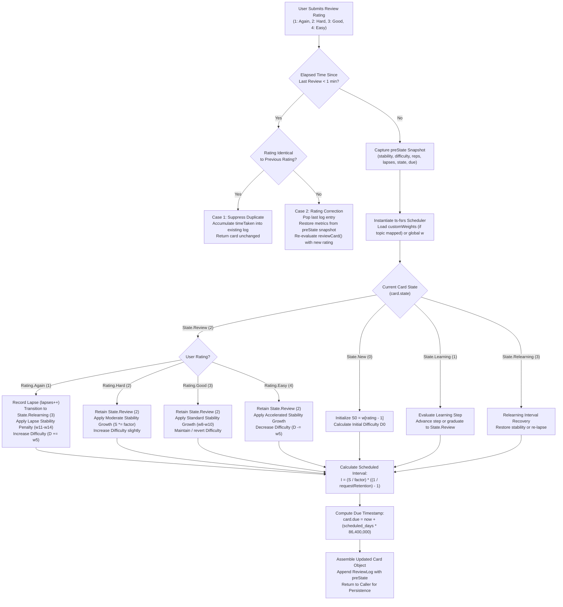

# Spaced Repetition Engine (FSRS v4.5 & WASM Optimizer)

## 1. Theoretical Foundations & Mathematics

AlgoRecall replaces traditional heuristic algorithms (such as SM-2 or Leitner) with the modern **Free Spaced Repetition Scheduler (FSRS v4.5)**. FSRS models human memory based on the **Three Component Model of Memory**:
1. **Stability ($S$)**: The time (in days) required for the probability of recalling a memory to decline from 100% to the target request retention (default: $90\%$, or $0.90$).
2. **Difficulty ($D$)**: The inherent conceptual difficulty of the problem, measured on a continuous linear scale from $1.0$ (easiest) to $10.0$ (hardest).
3. **Retrievability ($R$)**: The probability that the user can successfully recall the problem solution at any point in time $t$ since the last review.

### 1.1 Memory Retrievability Equation
FSRS models memory decay using a power-law forgetting curve:

$$R(t, S) = \left(1 + \text{factor} \times \frac{t}{S}\right)^{\text{decay}}$$

Where:
- $\text{decay} = -0.5$ (governs power decay rate).
- $\text{factor} = \frac{19}{81} \approx 0.2345679$.
- $t$ is the elapsed time in days since the last review.
- $S$ is the current memory stability in days.

When $t = S$, $R(S, S) = (1 + 0.2345679)^{-0.5} \approx 0.90$ (exactly matches the $90\%$ request retention target).

### 1.2 The 17-Weight Parameter Vector (`DEFAULT_FSRS_W`)
Defined in [`features/common/constants.ts`](file:///Users/anmolrastogi/Documents/GitHub/algomonster-fsrs-extension/features/common/constants.ts):

```typescript
export const DEFAULT_FSRS_W: number[] = [
    0.4, 0.6, 2.4, 5.8, 4.93, 0.94, 0.86, 0.01, 1.49, 0.14, 0.94, 2.18, 0.05, 0.34, 1.26, 0.29, 2.61
];
```

| Parameter Index | Parameter Role | Practical Significance |
|---|---|---|
| `w[0]` - `w[3]` | **Initial Stability ($S_0$)** for ratings Again(1), Hard(2), Good(3), Easy(4) | Establishes starting intervals (0.4d, 0.6d, 2.4d, 5.8d) for brand new cards. |
| `w[4]` | **Initial Difficulty ($D_0$)** | Baseline starting difficulty anchor when rating Good. |
| `w[5]` | **Difficulty Step Scaling** | Controls how rapidly difficulty increases/decreases based on ratings. |
| `w[6]` | **Mean Reversion Factor** | Pulls difficulty back toward the mean over extended repetitions. |
| `w[7]` | **Stability Decay Coefficient** | Governs retrievability decay rate in stability calculations. |
| `w[8]` - `w[10]` | **Stability Growth (Recall Success)** | Exponential growth coefficients expanding stability when rating Good/Easy. |
| `w[11]` - `w[14]` | **Stability Lapse Recovery (Recall Failure)** | Post-lapse stability floor and recovery dampening after rating Again. |
| `w[15]` - `w[16]` | **Short-Term Bonus & Penalty** | Dampening adjustments for premature or overdue reviews. |

---

## 2. Spaced Repetition Engine Flowchart (Diagram 7)

The following diagram maps out how review input ratings drive stability transitions, difficulty adjustments, and scheduled due date calculation.



---

## 3. WebAssembly WASI Parameter Optimizer

AlgoRecall includes a WebAssembly/WASI training engine implemented in [`features/tracker/scheduler/fsrsOptimizer.ts`](file:///Users/anmolrastogi/Documents/GitHub/algomonster-fsrs-extension/features/tracker/scheduler/fsrsOptimizer.ts):

### 3.1 WASI Execution Model
The optimizer uses `@open-spaced-repetition/binding` compiled to `wasm32-wasi` (`fsrs-binding.wasm32-wasi.wasm`).
- Runs inside a dedicated Web Worker (`wasi-worker-browser.mjs`) to prevent blocking the extension UI thread.
- Minimum data threshold: **1,000 historical reviews** across multiple cards (`OPTIMIZER_DEFAULT_THRESHOLD`).
- Runs **50 training epochs** using log-loss minimization to fit the 17 weights to the user's specific learning speed and forgetting curve.

### 3.2 Heuristic SGD Fallback (`fsrsOptimizerFast.ts`)
In environments where WebAssembly WASI or Web Workers are restricted (e.g., specific browser security modes or sandboxed tabs), [`FsrsOptimizerFast`](file:///Users/anmolrastogi/Documents/GitHub/algomonster-fsrs-extension/features/tracker/scheduler/fsrsOptimizerFast.ts) provides a pure JavaScript fallback:
- Tunes initial stability parameters (`w[0]` through `w[3]`) using stochastic gradient descent.
- Compares empirical recall rates against target retention ($90\%$) and adjusts baseline weights incrementally.
- Zero external binary dependencies; runs safely in any JavaScript environment.
