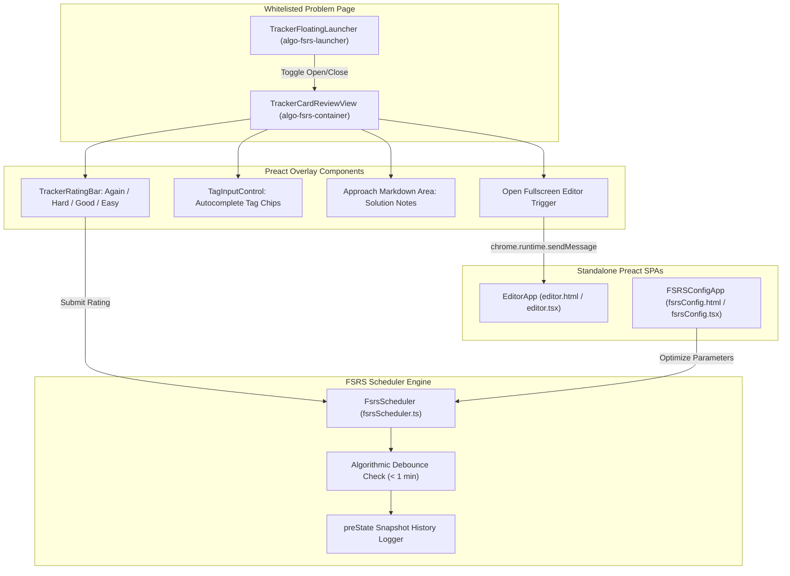
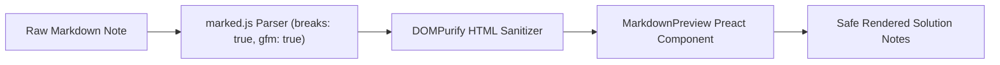

# Tracker & Editor Feature Module

This document provides a detailed breakdown of the **Tracker** overlay UI, full-screen Markdown **Editor**, and FSRS parameter **Configuration** modal in **AlgoRecall**. All UI components are implemented with **Preact 11 and TypeScript** (`.tsx`).

---

## 🧩 Module Overview & Preact Layout

The Tracker module comprises three primary components:

* **Floating Tracker Launcher & Overlay (`features/tracker/tracker.tsx`)**: 
  Injected into whitelisted coding problem pages (LeetCode, AlgoMonster, etc.). Renders floating launcher pill (`TrackerFloatingLauncher`), review card deck (`TrackerCardReviewView`), topic tag chips, and FSRS rating buttons (`TrackerRatingBar`).
* **Full-Screen Markdown Editor (`features/tracker/editor/editor.tsx`)**: 
  Standalone Preact SPA (`editor.html` -> `<EditorApp />`) allowing rich editing of card metadata (problem title, URL, tags, approach notes, and Big-O time/space complexity inputs). Features live GitHub Flavored Markdown preview sanitized via DOMPurify.
* **FSRS Configuration Modal (`features/tracker/config/fsrsConfig.tsx`)**: 
  Standalone Preact SPA (`fsrsConfig.html` -> `<FSRSConfigApp />`) providing 17-parameter weights inputs (`WeightsInputsGrid`), retention sliders, tag-specific profiles (`TagProfilesList`), and WASM optimizer triggers.
* **Abstract Scheduler Base (`features/tracker/scheduler/scheduler.ts`)**: 
  Base class defining card generation and rating transition interfaces extended by `FsrsScheduler`.

---

## ⚡ Algorithmic Debouncing & Rating Corrections

To prevent accidental double-clicks or key mashing from corrupting FSRS stability metrics, `FsrsScheduler` implements rapid re-review debouncing (< 1 minute window).

### Scenario 1: Duplicate Rating Submission (< 1 minute)
If a user clicks the same rating button twice in under 1 minute:
* FSRS calculation is **suppressed**.
* Additional review duration is added to the existing log entry.
* The review count and history log length remain unchanged.

### Scenario 2: Rating Correction (< 1 minute)
If a user mis-clicks `Good` and immediately changes their selection to `Again`:
1. The last review log entry is popped from `historyLog`.
2. Card mathematical parameters are restored to the `preState` snapshot saved prior to the mis-click.
3. The new rating is applied cleanly against the restored `preState`.

---

## 📝 Markdown Sanitization & Problem Approach Editor (`editor.tsx`)

The full-screen problem editor is a Preact SPA (`EditorApp`) featuring:
* **`EditorHeader`**: Problem title input, platform source badge, and auto-save status indicator.
* **`ComplexityInputs`**: Big-O notation fields for Time Complexity (e.g. `O(N log N)`) and Space Complexity (e.g. `O(1)`).
* **`MarkdownPreview`**: Split-pane or toggle preview rendering markdown with GitHub Flavored syntax.
* **XSS Defense**: Sanitizes all HTML output using DOMPurify through [`features/common/markdown.ts`](file:///Users/anmolrastogi/Documents/GitHub/algomonster-fsrs-extension/features/common/markdown.ts).

---

## 🔗 Related Documentation
* 📘 [Architecture Overview](file:///Users/anmolrastogi/Documents/GitHub/algomonster-fsrs-extension/docs/architecture/overview.md)
* 🧮 [FSRS Algorithm Math](file:///Users/anmolrastogi/Documents/GitHub/algomonster-fsrs-extension/docs/scheduler-wasm/fsrs-algorithm.md)
* ⚡ [WASM & Fast Optimizer Engine](file:///Users/anmolrastogi/Documents/GitHub/algomonster-fsrs-extension/docs/scheduler-wasm/optimizer-wasm.md)
* 📖 [FSRS Rating & State Transition Guide](file:///Users/anmolrastogi/Documents/GitHub/algomonster-fsrs-extension/docs/scheduler-wasm/rating-guide.md)
