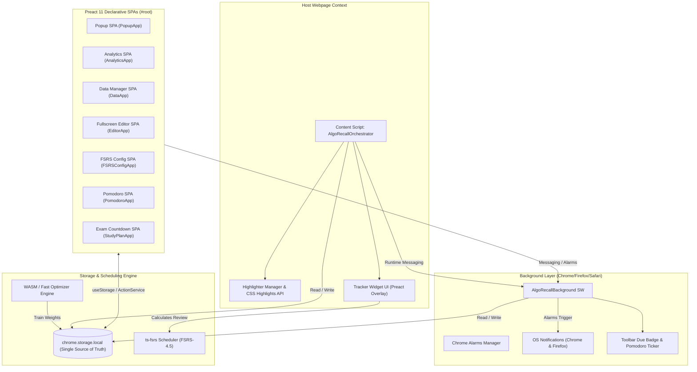

# AlgoRecall Architecture & Technical Documentation Index

Welcome to the comprehensive technical documentation for **AlgoRecall: Coding Interview Spaced Repetition & Highlighter Extension**. 

The extension is implemented using **Preact 11**, **TypeScript 5**, and **Manifest V3**, supporting **Google Chrome**, **Mozilla Firefox**, and **Apple Safari** (macOS and iOS/iPadOS). It integrates the **Free Spaced Repetition Scheduler (FSRS-4.5)** algorithm and WebAssembly (WASM) parameter optimization.

---

## 🏛️ Documentation Layout

```text
docs/
├── architecture/          # High-level MV3 system design, Preact UI architecture, & state distribution
├── features/              # UI feature modules (Tracker, Dashboard, Analytics, Highlighter, Common, Customization, Requirements)
├── scheduler-wasm/        # FSRS algorithm theory, Rating selection guide, WASM optimizer, and performance benchmarks
├── runtime-core/          # Content script orchestrator, background service worker, & types
├── testing/               # Jest, Playwright E2E, mock infrastructure, & artifact isolation audits
└── index.md               # Root Table of Contents (This file)
```

---

## 📑 Complete Table of Contents

### 1. Architecture & System Design
* 📘 [Architecture Overview](./architecture/overview.md) — Multi-tier MV3 cross-browser architecture, 16 Preact single-page applications, service worker lifecycle, and runtime messaging.
* 🔄 [End-to-End Data Pipelines](./architecture/data-flow.md) — Data flow connecting Preact SPAs, Chrome Storage, Background Worker, Content Scripts, and WASM runtime.
* 📦 [State Management Architecture](./architecture/state-management.md) — Separation between Preact component state and persistent storage, custom `useStorage` hook, and reactive storage sync.

### 2. Feature Modules & Customization
* 🎯 [Tracker & Editor](./features/tracker.md) — In-page review overlay, full-screen Markdown notes editor, Big-O complexity inputs, rapid debouncing, and preState snapshots.
* 📊 [Dashboard & Views](./features/dashboard.md) — Preact dashboard suite: Popup, Heatmap, Forecast, Pomodoro timer, Exam Countdown Mode, Summary generator, and History.
* 📈 [Analytics Engine](./features/analytics.md) — Algorithmic memory health, true retention curves, exam readiness forecast, velocity sparklines, confidence bands, and simulation sliders.
* 🖍️ [Highlighter & Options](./features/highlighter.md) — In-page text selection highlighter, CSS Custom Highlights API integration, pure underline rendering, selection preservation, and custom palette editor.
* 🛠️ [Common Utilities & Shared Infrastructure](./features/common.md) — Shared Preact component library (`Toggle`, `useStorage`, `TagChip`), streaming Gzip JSONL `BackupManager`, FNV-1a checksums, Help Center SPA with Privacy Policy, and theme sync.
* ⚙️ [Developer & Customization Guide](./features/customization.md) — Recipes for registering new coding platforms, creating custom highlighter palettes, tuning FSRS parameters, and editing CSS design tokens.
* 📋 [Feature Requirements Backlog](./features/requirements.md) — Comprehensive feature backlog, requirements matrix (P0–P3), and open design questions.

### 3. FSRS Scheduler & WASM Engine
* 🧮 [FSRS Algorithm & Math](./scheduler-wasm/fsrs-algorithm.md) — Mathematical foundations of FSRS-4.5, initial stability/difficulty formulas, retrievability decay, and state transitions.
* 📖 [FSRS Rating & State Transition Guide](./scheduler-wasm/rating-guide.md) — User and algorithmic guide for rating selection (`Again`, `Hard`, `Good`, `Easy`), state transition matrix, and partial recall strategies.
* ⚡ [WASM & Fast Optimizer](./scheduler-wasm/optimizer-wasm.md) — `@open-spaced-repetition/binding` WASM binding, WASI worker execution, parameter training, and `FsrsOptimizerFast` SGD fallback.
* 🚀 [Performance & Memory](./scheduler-wasm/performance.md) — WASM memory safety bounds, main-thread yielding heuristics, debouncing performance, and benchmark comparisons.

### 4. Runtime Core
* 🖥️ [Content Scripts & DOM Orchestration](./runtime-core/content-scripts.md) — `AlgoRecallOrchestrator`, DOM MutationObserver, SPA client-side history navigation, and `Notifier` alerts.
* ⚙️ [Background Service Worker](./runtime-core/background-service.md) — `AlgoRecallBackground` service worker, `chrome.alarms` setup, quiet hours, push notifications, and background Pomodoro ticker.
* 📐 [Global Types & Utilities](./runtime-core/utils-and-types.md) — Core domain types (`domain.ts`), backup types (`backup.ts`), WASM declarations (`wasm-runtime.d.ts`), and Chrome extension types.

### 5. Testing & Verification
* 🧪 [Test Suite Overview](./testing/test-suite-overview.md) — Jest configuration, Playwright setup, `chromeMock.js` mock environment, and coverage reporters.
* 🔬 [Unit & Component Test Suites](./testing/unit-tests.md) — Comprehensive breakdown of 89 unit/component test modules covering FSRS, `dataUtils`, Preact components, and `backupManager`.
* 🎭 [E2E & Integration Tests](./testing/e2e-integration.md) — Multi-browser Playwright test suite (`test:chrome`, `test:firefox`, `test:safari`) and integration test scenarios.

---

## 🔗 Project Meta Documentation & Store Listings

* 🏪 [Chrome Web Store Listing & Privacy Guide](../CHROMEWEBSTORE.md) — Production store description, permissions justifications, and privacy model.
* 🤖 [Architecture & Agent Rules (`AGENTS.md`)](../AGENTS.md) — Rules for TypeScript compilation, Webpack `CopyPlugin` safety, cross-browser flags, and build gates.
* 📜 [Third Party Licenses](../THIRD_PARTY_LICENSES.md) — License declarations for bundled third-party libraries (ts-fsrs, marked, etc.).

---

## 🧩 High-Level Module Relationship Diagram


