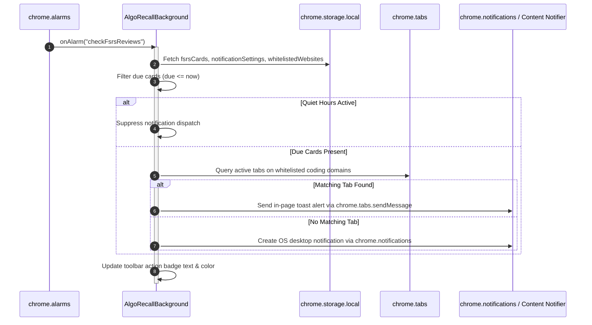

# Background Service Worker Architecture

This document details the background service worker implementation ([`background/background.ts`](file:///Users/anmolrastogi/Documents/GitHub/algomonster-fsrs-extension/background/background.ts)), class structure (`AlgoRecallBackground`), alarm/notification scheduling, Pomodoro timer synchronization, and **cross-browser API compatibility** (Chrome, Firefox, Safari).

---

## ⚙️ Service Worker Lifecycle & Event Binding

The background service worker is instantiated as an object-oriented class:

```typescript
export class AlgoRecallBackground {
    private pomodoroIntervalId: ReturnType<typeof setInterval> | null = null;
    private isCheckingDueCards: boolean = false;

    constructor() {
        this.init();
    }

    async init(): Promise<void> {
        this.bindEvents();
        await this.resumePomodoroBackground();
        await this.updateDueCardsBadge();
    }

    /**
     * Binds all Chrome API event listeners.
     *
     * Safari-specific: chrome.notifications and chrome.downloads are guarded
     * using build-time flags (BROWSER_CONFIG.supportsNotifications).
     */
    bindEvents(): void {
        chrome.runtime.onInstalled.addListener(this.handleInstalled.bind(this));

        // chrome.alarms is supported across Chrome, Firefox, and Safari 14+
        if (BROWSER_CONFIG.supportsAlarms) {
            chrome.alarms.onAlarm.addListener(this.handleAlarm.bind(this));
        }

        chrome.webNavigation.onHistoryStateUpdated.addListener(this.handleHistoryStateUpdated.bind(this));
        chrome.storage.onChanged.addListener(this.handleStorageChanged.bind(this));
        chrome.runtime.onMessage.addListener(this.handleMessage.bind(this));

        // Keyboard Shortcut Commands Listener (Universal MV3 support)
        if (typeof chrome !== 'undefined' && chrome.commands?.onCommand) {
            chrome.commands.onCommand.addListener(this.handleCommand.bind(this));
        }

        // Safari does not support chrome.notifications — skip listener
        if (BROWSER_CONFIG.supportsNotifications) {
            chrome.notifications.onClicked.addListener(this.handleNotificationClicked.bind(this));
        }
    }
}
```

---

## 🌐 Cross-Browser Service Worker Differences

| Target | Manifest Declaration | Execution Lifecycle | Notifications | Alarms |
| :--- | :--- | :--- | :--- | :--- |
| **Chrome** | `"background": { "service_worker": "background/background.js" }` | Ephemeral Service Worker | Supported | Supported |
| **Firefox** | `"background": { "scripts": ["background/background.js"] }` | Background Script (Event-driven) | Supported | Supported |
| **Safari** | `"background": { "service_worker": "background/background.js" }` | Ephemeral Service Worker | **Disabled** (In-page toast fallback) | Supported (Safari 14+) |

---

## ⏰ Alarm Schedules & Periodic Review Checks

The background worker registers persistent alarms to periodically check for due flashcards:



---

## ⏱️ Pomodoro Background Ticker & State Sync

When a Pomodoro session starts, the service worker runs an interval ticker that updates the browser action icon badge:
1. Calculates `timeRemaining = targetEndTime - Date.now()`.
2. Formats badge text (`25m`, `45s`).
3. Uses badge background colors: Focus (`#1a73e8`), Short Break (`#1e8e3e`), Long Break (`#f29900`).
4. On completion, dispatches completion notification and advances to next phase.

---

## 🔗 Related Documentation
* 📘 [Architecture Overview](file:///Users/anmolrastogi/Documents/GitHub/algomonster-fsrs-extension/docs/architecture/overview.md)
* 🖥️ [Content Scripts & DOM Orchestration](file:///Users/anmolrastogi/Documents/GitHub/algomonster-fsrs-extension/docs/runtime-core/content-scripts.md)
* 📡 [End-to-End Data Pipelines](file:///Users/anmolrastogi/Documents/GitHub/algomonster-fsrs-extension/docs/architecture/data-flow.md)
