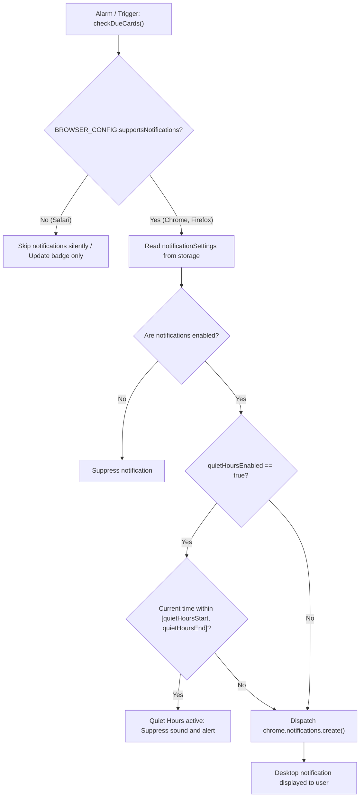
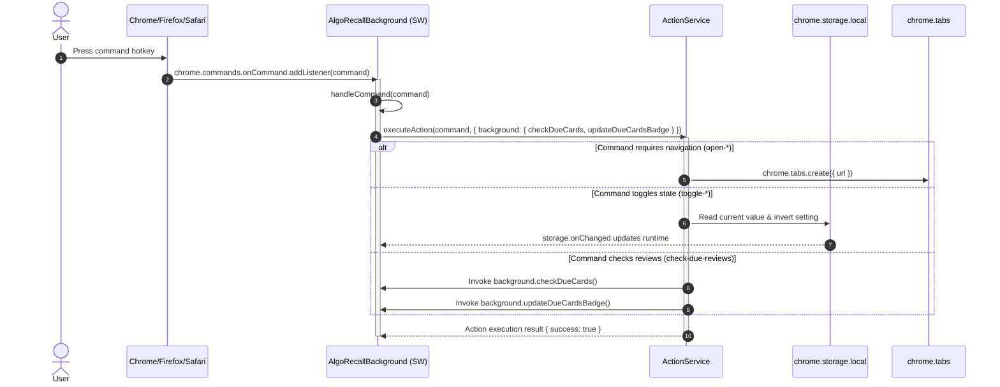

# Background Service Worker Architecture

This document details the background service worker implementation (`background/background.ts`), class structure (`AlgoRecallBackground`), alarm/notification handling, Pomodoro timer synchronization, and **cross-browser API compatibility** (Chrome, Firefox, Safari).

---

## ⚙️ Service Worker Lifecycle & Event Binding

The background service worker is instantiated as an object-oriented class:

```typescript
export class AlgoRecallBackground {
    private pomodoroIntervalId: ReturnType<typeof setInterval> | null = null;

    constructor() {
        this.init();
    }

    async init(): Promise<void> {
        this.bindEvents();
        await this.resumePomodoroBackground();
    }

    /**
     * Binds all Chrome API event listeners.
     *
     * Safari-specific: chrome.notifications and chrome.downloads are not supported
     * in Safari Web Extensions. Guards use build-time constants injected by
     * webpack DefinePlugin (BROWSER_CONFIG.supportsNotifications),
     * so the guarded branches are eliminated by tree-shaking in Chrome/Firefox builds.
     * Note: chrome.alarms IS fully supported on Safari 14+.
     */
    bindEvents(): void {
        chrome.runtime.onInstalled.addListener(this.handleInstalled.bind(this));

        // chrome.alarms is universally supported across Chrome, Firefox, and Safari
        if (BROWSER_CONFIG.supportsAlarms) {
            chrome.alarms.onAlarm.addListener(this.handleAlarm.bind(this));
        }

        chrome.webNavigation.onHistoryStateUpdated.addListener(this.handleHistoryStateUpdated.bind(this));
        chrome.storage.onChanged.addListener(this.handleStorageChanged.bind(this));
        chrome.runtime.onMessage.addListener(this.handleMessage.bind(this));

        // Keyboard Shortcut Commands Listener (Universal MV3 support)
        if (typeof chrome !== 'undefined' && chrome.commands?.onCommand) {
            chrome.commands.onCommand.addListener(this.handleCommand.bind(this));
        }

        // Safari does not support chrome.notifications — skip notification click listener.
        if (BROWSER_CONFIG.supportsNotifications) {
            chrome.notifications.onClicked.addListener(this.handleNotificationClicked.bind(this));
        }
    }
}
```

> **Build-time guards**: `BROWSER_CONFIG.supportsNotifications` and `BROWSER_CONFIG.supportsDownloads` are injected at bundle time via webpack `DefinePlugin`. In Chrome and Firefox builds they resolve to `true`, so the `if` bodies are kept as normal code. In Safari builds they resolve to `false`, and the entire blocks are eliminated by dead-code removal — no runtime overhead, no Safari crashes.

---

## 🌐 Cross-Browser API Support

| API | Chrome | Firefox | Safari | Handling |
|---|---|---|---|---|
| `chrome.runtime` | ✅ | ✅ | ✅ | Shared, no guard needed |
| `chrome.storage` | ✅ | ✅ | ✅ | Shared, no guard needed |
| `chrome.tabs` | ✅ | ✅ | ✅ | Shared, no guard needed |
| `chrome.webNavigation` | ✅ | ✅ | ✅ | Shared, no guard needed |
| `chrome.action` | ✅ | ✅ | ✅ | Shared, no guard needed |
| `chrome.commands` | ✅ | ✅ | ✅ | Shared Commands API for keyboard shortcuts |
| `chrome.alarms` | ✅ | ✅ | ✅ | Shared, no guard needed (supported in Safari 14+) |
| `chrome.notifications` | ✅ | ✅ | ❌ | Guarded with `BROWSER_CONFIG.supportsNotifications` |
| `chrome.downloads` | ✅ | ✅ | ❌ | Guarded with `BROWSER_CONFIG.supportsDownloads` (popup/backup/highlights) |

---

## ⏰ Chrome Alarms Registry

The background service worker registers alarms to drive periodic background tasks. **All alarm registration is universally supported across Chrome, Firefox, and Safari** (guarded by `BROWSER_CONFIG.supportsAlarms` which resolves to `true` for all targets).

```mermaid
graph TD
    subgraph Chrome Alarms (Chrome, Firefox, Safari)
        A1[checkFsrsReviews: Every N min]
        A2[snoozeFsrsReviews: Snooze delay]
        A3[smartReviewSchedule: Daily at 17:00]
        A4[weeklySummary: Every Monday 9 AM]
        A5[dailyNudge: Daily at 20:00]
        A6[pomodoroEnd: Exact targetEndTime]
    end

    subgraph Alarm Handlers
        H1[checkDueCards: Group by tags & notify]
        H2[handleWeeklySummary: Calculate 7-day review trend]
        H3[handleDailyNudge: Streak retention nudge]
        H4[handlePomodoroEnd: Advance phase & push notification]
    end

    A1 --> H1
    A3 --> H1
    A4 --> H2
    A5 --> H3
    A6 --> H4
```

### Guarded methods

Every method that touches `chrome.alarms` has a top-level guard. Although it resolves to `true` for Safari, this structure ensures safe compilation:

```typescript
async setupAlarm(): Promise<void> {
    if (!BROWSER_CONFIG.supportsAlarms) {
        Logger.info('Background', 'Skipping alarm setup — chrome.alarms not supported.');
        return;
    }
    // ... alarm setup
}
```

The same pattern applies to: `setupWeeklySummaryAlarm`, `setupDailyNudgeAlarm`, and the Pomodoro `handlePomodoroAction` alarm backup mechanism.

---

## 🔔 Notification Dispatch

All OS notification creation/clearing flows through `dispatchSystemNotification()`, which has a single top-level guard:

```typescript
private dispatchSystemNotification(id, title, message, priority, requireInteraction): void {
    // Safari does not support chrome.notifications — skip silently.
    if (!BROWSER_CONFIG.supportsNotifications) {
        Logger.info('Background', `Skipping notification '${id}' — not supported on this platform.`);
        return;
    }
    // ... chrome.notifications.clear / create
}
```

This single guard covers all notification dispatch paths (review alerts, weekly summary, daily nudge, Pomodoro completion).

---

## 🌙 Quiet Hours Filter

Before firing desktop review notifications (`checkDueCards`), `AlgoRecallBackground` evaluates user-configured quiet hours (e.g. 23:00 to 07:00), automatically suppressing alerts during sleep windows.

This logic only runs on Chrome/Firefox where `chrome.notifications` is available. On Safari the entire notification path is skipped before reaching the quiet hours check.



---

## ⌨️ Commands API & Headless Action Dispatcher (`handleCommand`)

The service worker acts as the central runtime receiver for all browser-registered keyboard shortcuts triggered via the Commands API:

```typescript
async handleCommand(command: string): Promise<void> {
    try {
        Logger.info('Background', `Received browser keyboard command: ${command}`);
        const result = await ActionService.executeAction(command as CommandActionId, {
            background: {
                checkDueCards: this.checkDueCards.bind(this),
                updateDueCardsBadge: this.updateDueCardsBadge.bind(this)
            }
        });
        if (!result.success) {
            Logger.warn('Background', `Command execution did not succeed: ${command}`, { error: result.error });
        }
    } catch (err) {
        Logger.error('Background', `Error handling command ${command}`, { err });
    }
}
```

* **Decoupled Execution**: Because popup HTML/DOM contexts are transient and torn down when dismissed, `handleCommand` passes background function references (`checkDueCards`, `updateDueCardsBadge`) directly into [`ActionService`](file:///Users/anmolrastogi/Documents/GitHub/algomonster-fsrs-extension/features/common/services/actionService.ts), ensuring complete functionality without depending on open UI views.



---

## 🏷️ Action Icon Badge Counter & Synchronization (`updateDueCardsBadge`)

`AlgoRecallBackground.updateDueCardsBadge()` manages the browser action toolbar badge:

1. **Card Calculation**: Queries `fsrsCards` from `chrome.storage.local` and computes cards where `due <= Date.now()`.
2. **User Preference Check**: Inspects `notificationSettings.badgeEnabled` (defaults to `true`). If disabled by the user, the badge text is cleared (`""`).
3. **Badge Rendering**: Calls `chrome.action.setBadgeText({ text: count > 0 ? String(count) : "" })` and configures badge color (`#e74c3c`).
4. **Reactivity**: Re-evaluates whenever storage changes are observed on `fsrsCards` or `notificationSettings`.

---

## 🍎 Safari Behaviour Summary

On Safari, the background service worker initialises successfully and handles:

- `chrome.runtime.onInstalled` ✅ — storage defaults set on install
- `chrome.webNavigation.onHistoryStateUpdated` ✅ — SPA routing detected
- `chrome.storage.onChanged` ✅ — live settings sync
- `chrome.runtime.onMessage` ✅ — all message actions handled
- `chrome.alarms.*` ✅ — all background sync, daily nudges, and Pomodoro backup alarms work natively.

Silently skipped on Safari:

- `chrome.notifications.*` — no OS-level push notifications
- `chrome.downloads.*` — no direct API downloads (uses anchor-click fallback)

---

## 🔗 Related Documentation
* 📘 [Architecture Overview](file:///Users/anmolrastogi/Documents/GitHub/algomonster-fsrs-extension/docs/architecture/overview.md)
* 📊 [Dashboard Views](file:///Users/anmolrastogi/Documents/GitHub/algomonster-fsrs-extension/docs/features/dashboard.md)
* 📐 [Global Types & Utilities](file:///Users/anmolrastogi/Documents/GitHub/algomonster-fsrs-extension/docs/runtime-core/utils-and-types.md)
