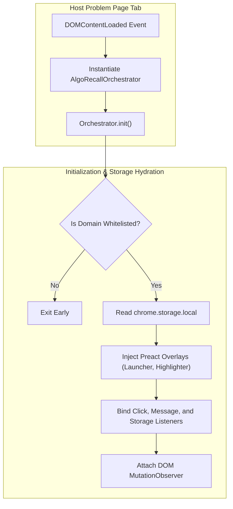

# Content Scripts & DOM Orchestration

This document details the content script architecture ([`content/content.ts`](file:///Users/anmolrastogi/Documents/GitHub/algomonster-fsrs-extension/content/content.ts)), `AlgoRecallOrchestrator`, DOM MutationObserver debouncing, SPA history navigation handling, and in-page Preact overlay rendering.

---

## 🖥️ Content Script Architecture & Preact Injection

The content script pipeline comprises:
* **`content.ts`**: Main orchestrator bootstrapping `AlgoRecallOrchestrator`.
* **`state.ts`**: Shared content scope state object (`AlgoRecallState`).
* **`utils.ts`**: Content utilities (DOM selectors for problem titles, tag auto-detection, and CSS Custom Highlights API).
* **`notifications.ts`**: `Notifier` class rendering interactive toast alerts directly in the host webpage.
* **`features/tracker/tracker.tsx`**: In-page floating review launcher and rating overlay.
* **`features/highlighter/highlighter.tsx`**: In-page text selection highlighter and anchored Preact tooltip view (`HighlighterTooltipView`).



---

## 🔄 MutationObserver & SPA Navigation Debouncing

Coding platforms (e.g. LeetCode, AlgoMonster, Codeforces) rely heavily on client-side routing. Problem descriptions and elements re-render dynamically without full page reloads.

### MutationObserver Strategy
* Observes `document.body` for `childList`, `subtree`, and `characterData` mutations.
* Debounces highlight re-applications by 100 ms (`highlightDebounceTimer`).
* Re-injects launcher buttons if host page hydration replaces them.
* Re-parses problem titles and tags on client-side URL changes.

```typescript
this.domObserver = new MutationObserver(() => {
    if (this.state.highlightDebounceTimer) clearTimeout(this.state.highlightDebounceTimer);
    this.state.highlightDebounceTimer = setTimeout(() => {
        this.highlighter.applyHighlightsForCurrentPage();
        if (document.body && !document.getElementById('algo-fsrs-launcher')) {
            this.tracker.createUI();
        }
    }, 100);
});
```

---

## 🔔 In-Page Interactive Notifications (`Notifier`)

When review reminders are triggered while a user is studying on an active whitelisted tab, `Notifier.showPageNotification()` injects a styled, non-intrusive card directly into the DOM:
* **Review Due Alert**: Presents problem title, due count, "Review Now" button, and "Snooze 15m" option.
* **Snooze Handling**: Dispatches a `snooze_notification` message to the background service worker to pause alarms for 15 minutes.

---

## 🔗 Related Documentation
* 📘 [Architecture Overview](file:///Users/anmolrastogi/Documents/GitHub/algomonster-fsrs-extension/docs/architecture/overview.md)
* 🎯 [Tracker & Editor Feature Module](file:///Users/anmolrastogi/Documents/GitHub/algomonster-fsrs-extension/docs/features/tracker.md)
* 🖍️ [Highlighter & Annotation Manager](file:///Users/anmolrastogi/Documents/GitHub/algomonster-fsrs-extension/docs/features/highlighter.md)
* ⚙️ [Background Service Worker](file:///Users/anmolrastogi/Documents/GitHub/algomonster-fsrs-extension/docs/runtime-core/background-service.md)
