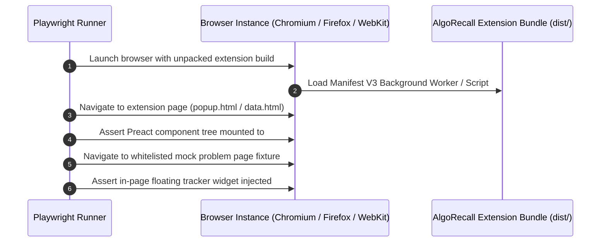

# Integration & Playwright E2E Testing

This document describes the integration test suites (`tests/integration/`) and Playwright end-to-end browser testing (`tests/e2e/`) in **AlgoRecall**. It outlines multi-component testing workflows across Chrome, Firefox, and Safari.

---

## 🔗 Integration Testing Suite (`tests/integration/`)

Integration tests evaluate multi-component interactions across storage, the FSRS scheduler, and UI overlays. While they run under Jest using Node.js/jsdom with mocked Chrome APIs, they instantiate multiple real service classes simultaneously.

### Key Integration Scenarios
1. **`tracker.test.js`**:
   * Evaluates the complete lifecycle of creating a card on a problem page, reviewing it with rating `Good`, updating `fsrsCards` in storage, and verifying launcher badge updates.
2. **`multiCard.test.ts`** (`tests/unit/features/tracker/multiCard.test.ts`):
   * Tests concurrent reviews across multiple cards with different tags.
   * Asserts tag-level aggregation correctness in `DataUtils.getStatsByTag()`.
3. **`test_opt.js`**:
   * Integration test verifying WASM parameter optimizer execution and storage write-back.

---

## 🎭 Playwright E2E Browser Testing (`tests/e2e/`)

Playwright tests run against production Webpack bundles in **real browser instances** with the compiled extension loaded via CLI flags.

### Execution Workflow



### Running E2E Tests Across Target Browsers
```bash
# Run Chrome E2E tests (builds dist/chrome first)
npm run test:chrome

# Run Firefox E2E tests (builds dist/firefox first)
npm run test:firefox

# Run Safari E2E tests (builds dist/safari first)
npm run test:safari

# Run universal E2E test suite
npm run test:e2e
```

### Authoring E2E Tests
When adding new specifications in `tests/e2e/`:
1. **Always Build First**: Run `npm run test:e2e` (which automatically triggers `npm run build:chrome`). Playwright tests the `/dist` output directly; modifying source files will not reflect until built.
2. **Context Isolation**: Each test file spins up a fresh browser context with a clean extension installation. State (`chrome.storage.local`) is not shared between test files.
3. **Mock Pages**: Avoid navigating to live external websites. Use local HTML fixtures or strictly whitelisted static domains to guarantee test determinism.

---

## 🐛 Debugging Failing Tests

If a Playwright test fails in CI or locally, it generates trace artifacts in the `/test-results/` directory:
1. Open the Playwright Trace Viewer: `npx playwright show-trace path/to/trace.zip`
2. Scrub through the visual timeline, viewing DOM snapshots, console logs, and network requests.

---

## 🔗 Related Documentation
* 🧪 [Test Suite Overview](./test-suite-overview.md)
* 🔬 [Unit & Component Test Coverage](./unit-tests.md)
* 🎯 [Tracker Feature Module](../features/tracker.md)
* 🤖 [Architecture & Agent Rules](../../AGENTS.md)
