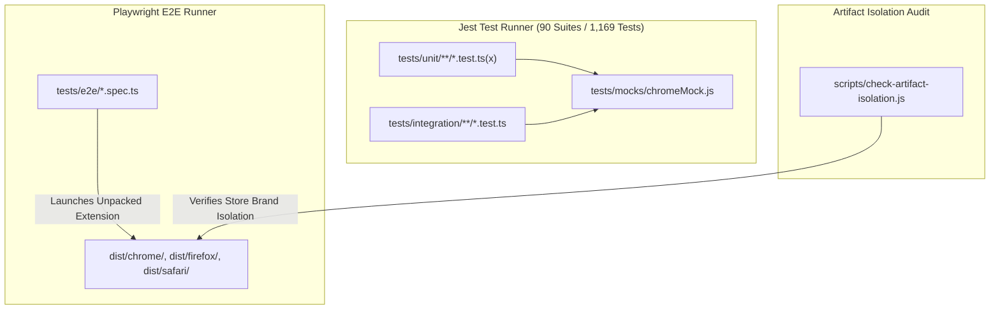

# Test Suite Architecture & Configuration Overview

This document provides a comprehensive technical breakdown of the testing infrastructure in **AlgoRecall**. It covers the 3-tier testing strategy, Jest configuration for Preact and TypeScript, Playwright E2E browser automation, artifact isolation audits, and execution commands.

---

## 🧪 Testing Tier & Directory Architecture

AlgoRecall enforces a strict 3-tier testing strategy. All testing code resides under `/tests`:

```text
tests/
├── mocks/
│   ├── chromeMock.js              # Comprehensive Chrome Extension API & storage mock
│   ├── importMetaPlugin.js        # Babel plugin for import.meta compatibility under Jest
│   └── styleMock.js               # CSS stylesheet stub for Jest
├── unit/                          # 90 Jest unit test suites covering TypeScript & Preact
│   ├── background/                # Background service worker & command tests
│   ├── content/                   # Content orchestrator, notifications, DOM utils
│   ├── build/                     # Webpack config & manifest consistency tests
│   └── features/
│       ├── common/                # BackupManager, logger, markdown, Toggle, useStorage
│       ├── dashboard/             # Popup, analytics, heatmap, history, forecast, pomodoro
│       ├── highlighter/           # Highlighter tooltip, options, manager components
│       └── tracker/               # FSRS scheduler, optimizer, editor, tracker widget
├── integration/                   # Multi-component workflow integration tests
├── e2e/                           # Playwright end-to-end browser extension loading tests
└── fixtures/                      # Mock card datasets and review logs
```

### Execution Flow


---

## 📦 Package Scripts (`package.json`)

| Script | Command | Purpose |
| :--- | :--- | :--- |
| `npm test` | `jest` | Executes all 90 Jest unit and integration test suites. |
| `npm run test:coverage` | `jest --coverage` | Generates LCOV and HTML coverage reports under `/coverage`. |
| `npm run check:isolation:all`| `npm run build:chrome && ... && node scripts/check-artifact-isolation.js` | Audits build output to ensure zero cross-browser string contamination (37 checks). |
| `npm run test:e2e` | `npm run build:chrome && playwright test` | Executes Playwright E2E browser tests against unpacked extension bundles. |
| `npm run test:chrome` | `playwright test --project=chrome` | Runs Playwright tests specifically for Google Chrome. |
| `npm run test:firefox` | `playwright test --project=firefox` | Runs Playwright tests specifically for Mozilla Firefox. |
| `npm run test:safari` | `playwright test --project=safari` | Runs Playwright tests specifically for Apple Safari. |

---

## ⚙️ Jest Configuration (`jest.config.js`)

* **Environment**: `jsdom` simulating browser DOM APIs required by Preact component trees.
* **TypeScript & JSX Support**: Configured with `ts-jest` supporting `jsxImportSource: 'preact'`.
* **Path Aliases**:
  - `@common/*` $\rightarrow$ `<rootDir>/features/common/*`
  - `@tracker/*` $\rightarrow$ `<rootDir>/features/tracker/*`
  - `@dashboard/*` $\rightarrow$ `<rootDir>/features/dashboard/*`
* **Coverage Thresholds**: Global threshold $\ge 65\%$; critical scheduler modules $\ge 90\%$.

---

## 🔗 Related Documentation
* 🔬 [Unit Test Suite Breakdown](file:///Users/anmolrastogi/Documents/GitHub/algomonster-fsrs-extension/docs/testing/unit-tests.md)
* 🎭 [E2E & Integration Tests](file:///Users/anmolrastogi/Documents/GitHub/algomonster-fsrs-extension/docs/testing/e2e-integration.md)
* 📘 [Architecture Overview](file:///Users/anmolrastogi/Documents/GitHub/algomonster-fsrs-extension/docs/architecture/overview.md)
